<p align="center">
  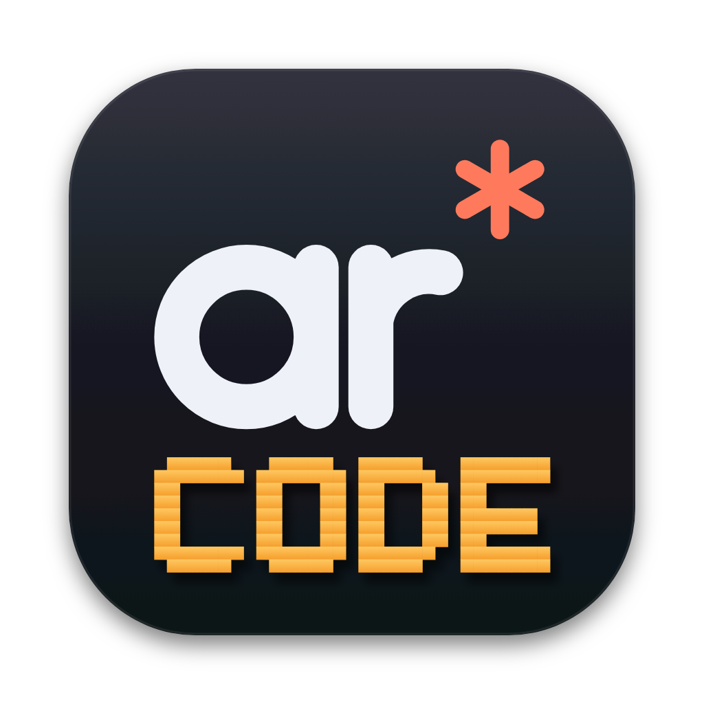
</p>

<h1 align="center">ARcode</h1>

<p align="center">
  A small, fast macOS workspace built around <a href="https://docs.claude.com/en/docs/claude-code/overview">Claude Code</a>
  and other terminal coding agents.<br>
  File tree, file viewer, terminal and a live view of what Claude is doing, in one window per project.
</p>

<p align="center">
  <a href="https://github.com/andrewrozumny/arcode/actions/workflows/ci.yml"></a>
  
  
</p>

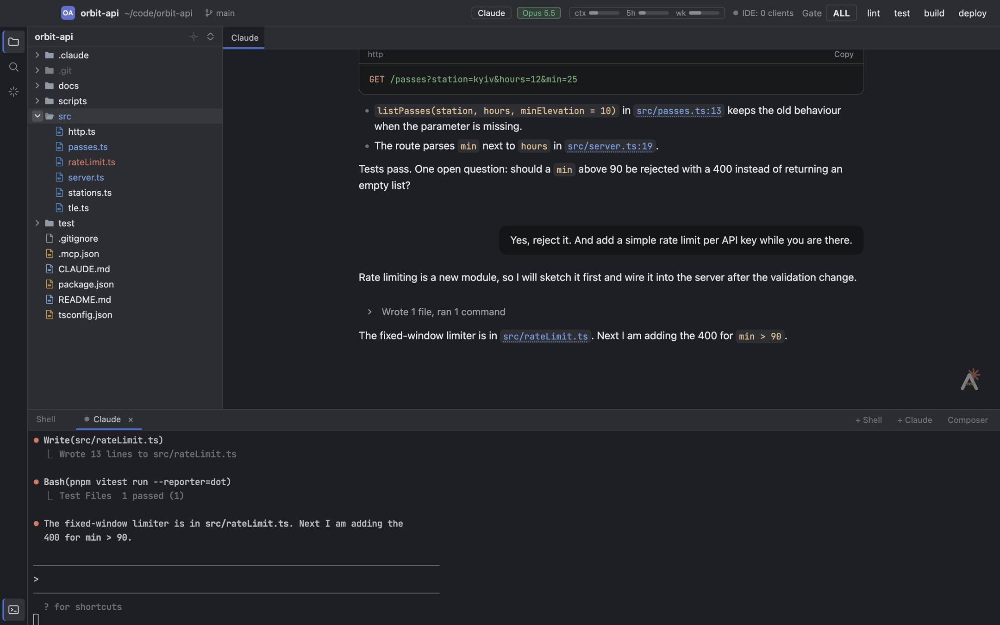

## Why

If most of your day happens inside Claude Code, a full IDE is mostly overhead: you need to see
the files, read a diff, glance at what the agent is doing and keep a few terminals open. ARcode is
exactly that and nothing more. It speaks the same IDE protocol as the VS Code and JetBrains
extensions, so Claude Code can open diffs and files in it without `/ide`, and it reads Claude
Code's own files to show sessions, usage, skills, MCP servers and hooks. It never sends anything
anywhere: the only network socket is the IDE bridge on 127.0.0.1.

## Features

### Claude feed

The pinned **Claude** tab shows the active session as a clean conversation, the way the Claude apps
do: prompts and answers as Markdown with highlighted code and clickable `file:line` links, tool
calls folded into short rows ("Edited 2 files, ran 1 command") that open into diffs and command
output, task lists, agent, question and plan cards and a working indicator. System reminders,
thinking and hook noise are hidden. It follows the active Claude terminal tab and updates live.

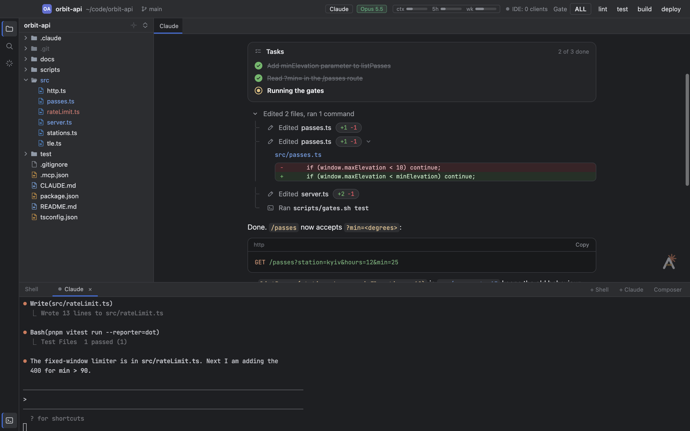

### Built-in Claude Code integration

- **IDE bridge without `/ide`.** Every window runs the IDE MCP server Claude Code looks for; terminals
  get the port, so diff review, open file, selection sharing and @-mentions work out of the box.
- **Header at a glance.** The active tab's model, context and 5-hour / weekly plan usage bars, and
  running subagents.
- **Claude panel.** An overview of the current session, plan usage and setup with problems
  highlighted, plus sessions (with resume), skills, plugins, MCP servers with live status, agents,
  hooks, CLAUDE.md files, token usage and the project's quality gates.
- **Live status per tab.** Busy, idle or waiting for you, with a notification and a dock badge when
  Claude needs input and the window is in the background.

| Overview | Sessions |
|---|---|
| 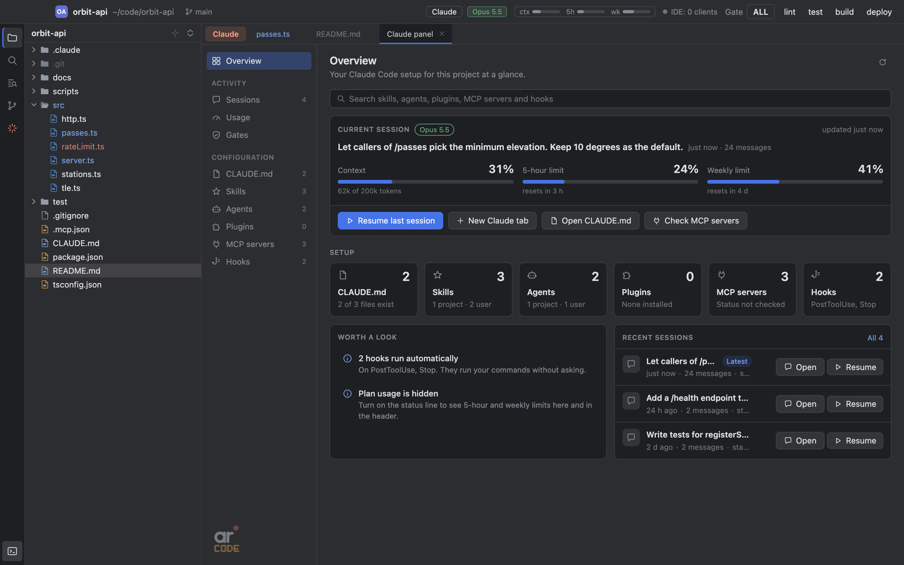 | 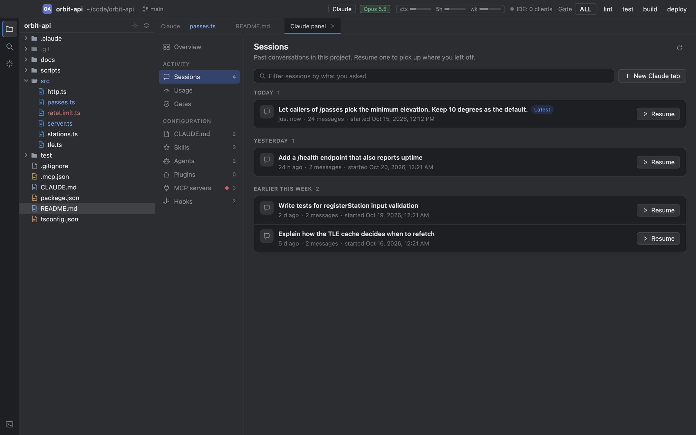 |
| **MCP servers** | **Skills** |
| 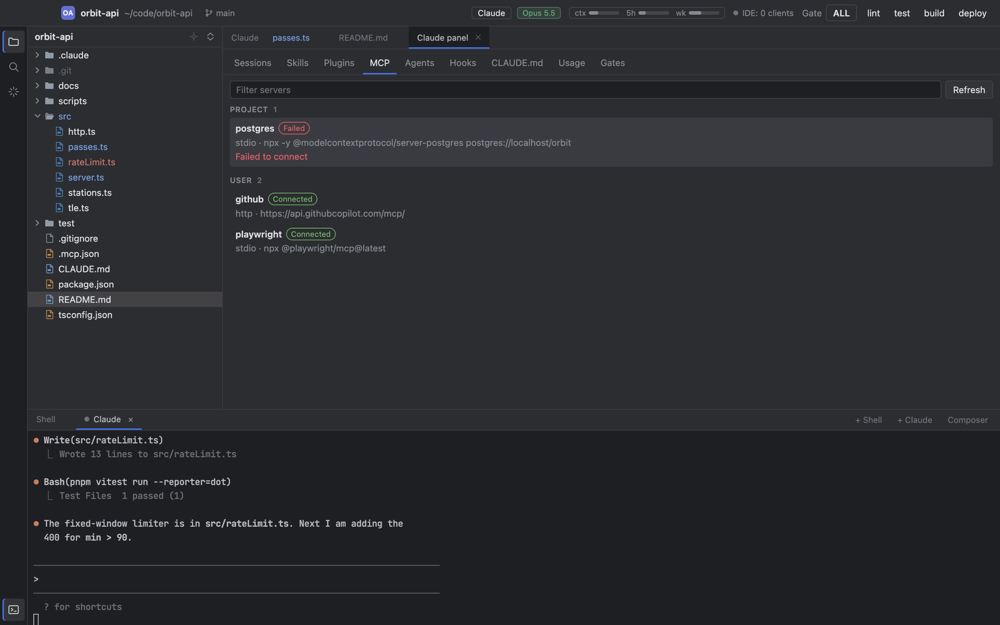 | 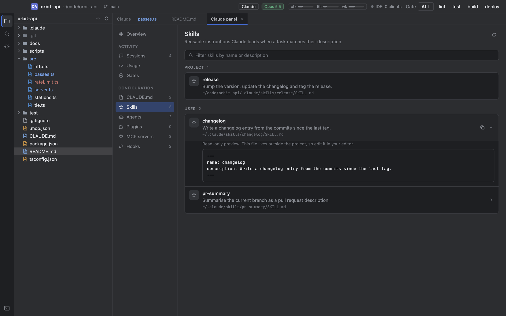 |
| **Usage** | **Gates** |
| 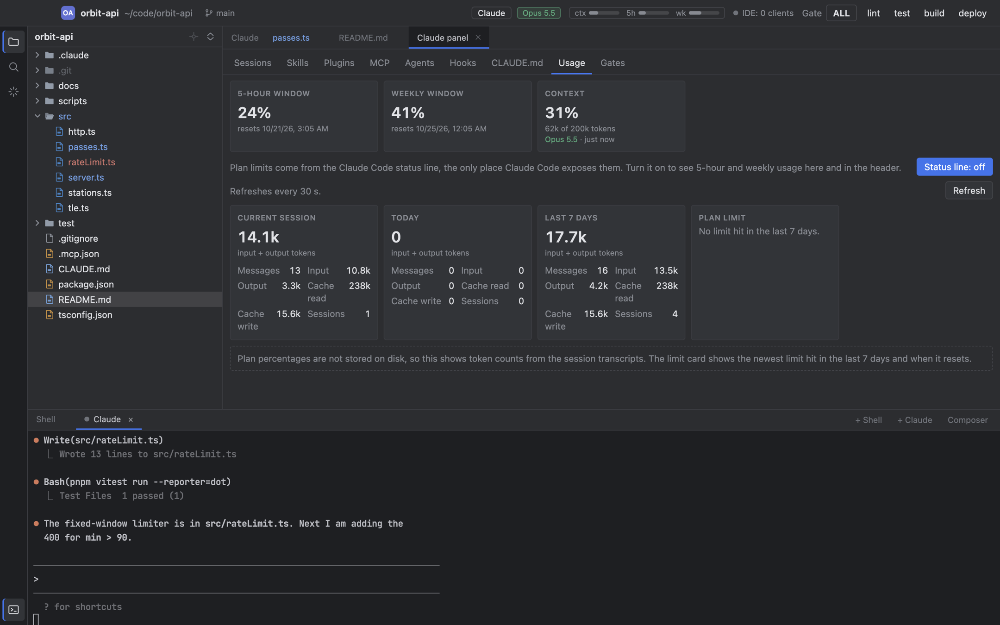 | 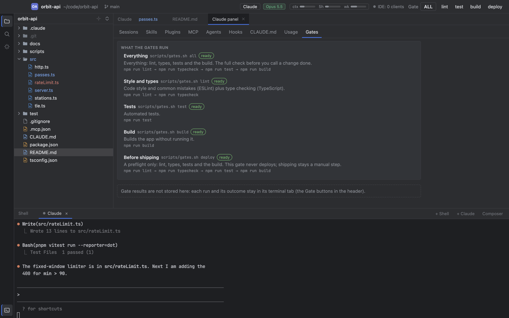 |

### Files and code

- **File tree.** Lazy and virtualised, respects `.gitignore`, marks git changes, create, rename,
  move to Trash, copy and paste with Finder, drag and drop, Import from Mac (Downloads, Recent,
  Screenshots).
- **Go to file** (Cmd+P) with fuzzy matching and `:line` jumps, and **Recent files** (Cmd+Shift+E).
- **Find in files** (Cmd+Shift+F): live project-wide search with case, whole word and regex
  toggles and a file mask, results grouped by file; uses ripgrep when installed, else `git grep`.
- **Changes** (Ctrl+Shift+G): every file changed against `HEAD` with +/- line counts, grouped by
  folder and updated live; Enter opens the file with its diff already shown. Review only, no git GUI.
- **Viewer and editor.** Syntax highlighting, type to edit with autosave and conflict detection,
  file tabs restored per project, side by side or
  unified diff against `HEAD`, Markdown preview, images with zoom and pan.

| Diff against HEAD | Markdown preview |
|---|---|
| 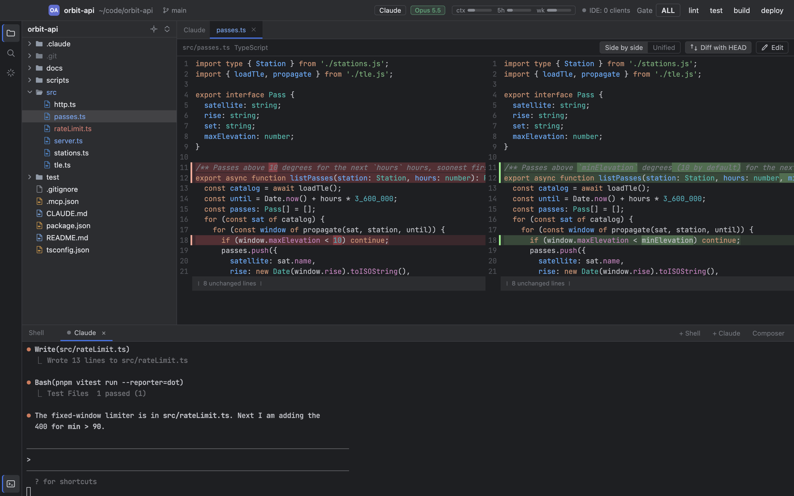 | 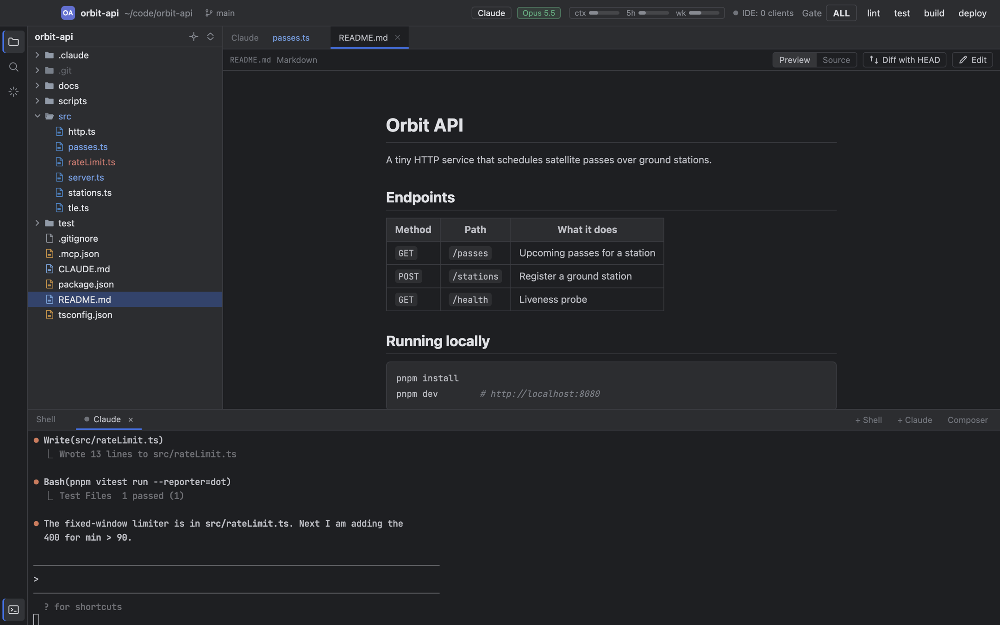 |

### Terminal

Shell, Claude and gate tabs on xterm.js with WebGL rendering; clickable file links, search, a
multi-line composer (images pasted into it are saved as files), and tabs plus Claude sessions
restored after a restart.

### Projects and gates

- **One window per project**, reopened at start. **Cmd+Shift+O** switches projects; `open -a ARcode
  <file or folder>` routes to the right window.
- **Quality gates.** The header buttons run `scripts/gates.sh <target>` (`all`, `lint`, `test`,
  `build`, `deploy`) of the open project in a terminal tab. Any project can adopt the convention.

| Go to file | Project switcher |
|---|---|
| 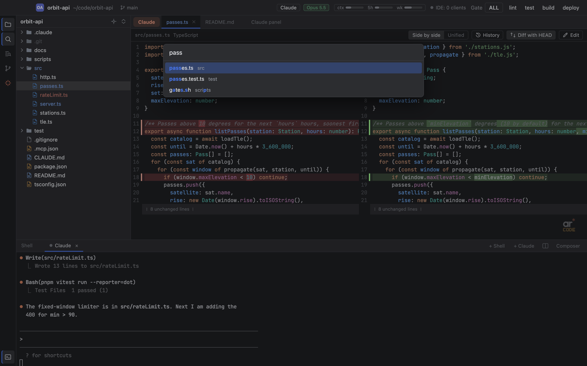 | 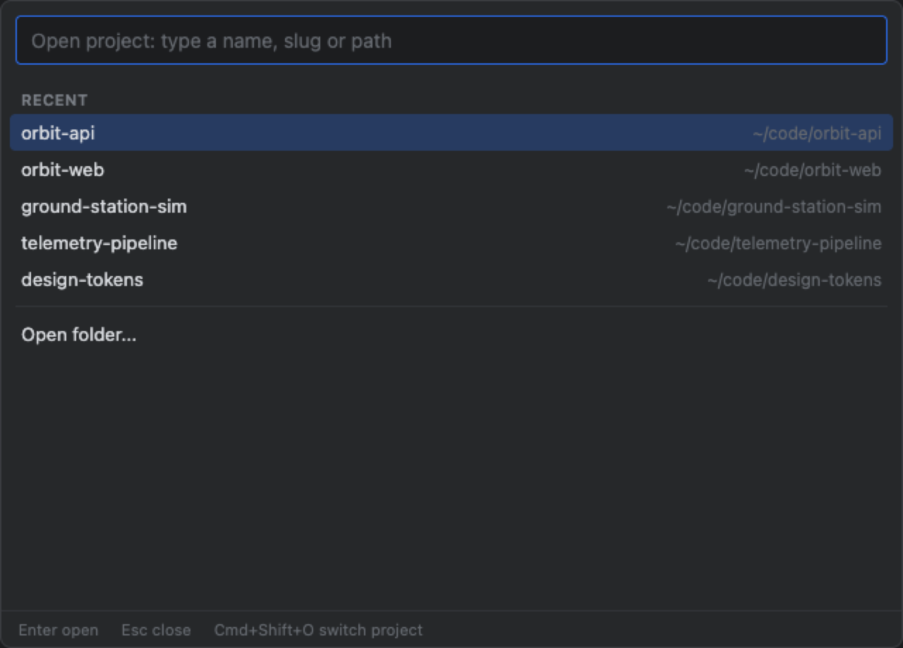 |

Out of scope on purpose: debugger, database client, git GUI, language intelligence.

## Performance

Measured on an M4 Pro MacBook (24 GB, macOS 26), development build, medians where several runs were taken:

| | ARcode |
|---|---|
| Window visible after launch | 243 ms |
| First file tree row | 515 ms |
| Memory, one project window | 381 MB footprint |
| Memory, plus Claude tabs and a 50 MB session in the feed | 488 MB footprint |
| Idle CPU | 0.6 to 1.9 % of one core |
| Claude feed: open a 50 MB session to the last message | 41 ms (reads only the last 255 KB) |
| Go to file in a 35,000-file project | 4 to 5 ms |
| App size on disk | 256 MB (Cursor.app 970 MB, PhpStorm.app 2.6 GB) |

`pnpm bench` runs the micro-benchmarks, `pnpm bench:app` the app-level suite.

Methodology, raw numbers and how to reproduce them: [docs/BENCHMARKS.md](docs/BENCHMARKS.md).

## Install

**Download.** Take `ARcode-<version>-arm64.dmg` (Apple Silicon) from the
[latest release](https://github.com/andrewrozumny/arcode/releases/latest), open it and drag ARcode
to Applications. The app is not signed or notarized yet, so macOS blocks the first launch; clear the
quarantine flag once:

```bash
xattr -dr com.apple.quarantine /Applications/ARcode.app
```

**Build from source.** Requirements: macOS 12+, Node.js 22.12+, pnpm 10 and the Xcode Command Line
Tools (node-pty is compiled against Electron's headers).

```bash
git clone https://github.com/andrewrozumny/arcode.git
cd arcode
pnpm install
scripts/install-app.sh      # builds ARcode.app and copies it to /Applications
```

To build without installing: `pnpm dist` puts the app in `dist/mac-arm64/ARcode.app`.

Then open a project: `open -a ARcode ~/code/my-project`, or launch ARcode and press Cmd+Shift+O.
Coming from Acode (the old name)? ARcode picks up your projects, layout and status line on the
first start.

## Keyboard shortcuts

| Shortcut | Action |
|---|---|
| Cmd+Shift+O | Switch project |
| Cmd+P | Go to file (`name:line` jumps to a line) |
| Cmd+Shift+F | Find in files |
| Ctrl+Shift+G | Changes against HEAD |
| Cmd+Shift+E | Recent files |
| Cmd+T / Cmd+W | New tab / close tab |
| Cmd+Shift+] / Cmd+Shift+[ | Next / previous tab |
| Cmd+\ | Split the terminal into two columns / focus the other column |
| Cmd+Shift+T | Reopen closed tab |
| Ctrl+Esc | New Claude tab |
| Cmd+Shift+J | Jump to the next Claude tab waiting for you |
| Cmd+Shift+Enter | Composer for multi-line terminal input |
| Cmd+1 / Cmd+2 | Toggle file tree / terminal |
| Cmd+E / Cmd+S | Toggle edit mode / save now (autosave is on by default) |
| Cmd+F / Cmd+L | Find in file / go to line |
| Cmd+D / Ctrl+G | Duplicate line or selection / select next occurrence (edit mode) |
| Cmd+Alt+K | Mention the selection in Claude (@file#lines) |

The full list is in the [user guide](docs/USER-GUIDE.md).

## Development

```bash
pnpm install          # also downloads Electron and rebuilds node-pty for it
pnpm dev              # run with hot reload (ARCODE_CWD=<folder> opens a folder directly)
scripts/gates.sh all  # lint (zero warnings), typecheck, tests and the production build
pnpm screenshots      # regenerate docs/screenshots from a demo sandbox
```

Stack: Electron, React, TypeScript, xterm.js, node-pty, CodeMirror. Start with
[docs/ARCHITECTURE.md](docs/ARCHITECTURE.md) and the decision records in
[docs/decisions/](docs/decisions/); contribution notes are in [CONTRIBUTING.md](CONTRIBUTING.md).

The screenshots above are generated, not staged by hand: `scripts/demo/` builds a throwaway home
folder with a made-up project and Claude Code session, launches the built app against it and
captures each view, so they never contain anyone's real data.

## Data and privacy

ARcode reads Claude Code's files under `~/.claude` and the project's `.claude/` and `.mcp.json`,
and writes only its own state to `~/Library/Application Support/ARcode`. It touches
`~/.claude/settings.json` only when you switch on the optional status line (a timestamped backup is
kept). Details: [docs/USER-GUIDE.md](docs/USER-GUIDE.md) and [docs/ARCHITECTURE.md](docs/ARCHITECTURE.md).

## License

[MIT](LICENSE)
