# ARcode user guide

ARcode is a small macOS workspace around terminal coding agents, mainly Claude Code. Each project
gets its own window with a file tree, a file viewer and a terminal dock. This guide covers
everyday use. For how the code is put together, see [ARCHITECTURE.md](ARCHITECTURE.md).

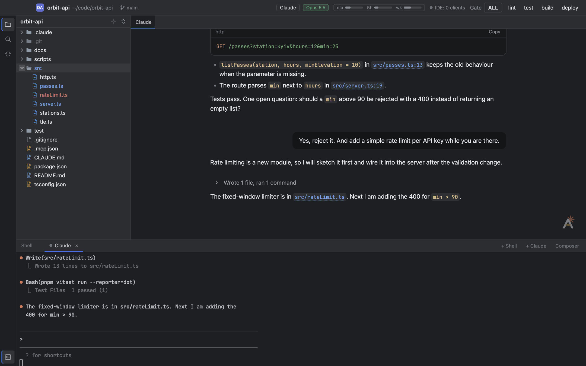

## Contents

- [Install](#install)
- [Open projects](#open-projects)
- [Window layout](#window-layout)
- [File tree](#file-tree)
- [Find in files](#find-in-files)
- [Changes](#changes)
- [File viewer](#file-viewer)
- [Terminal](#terminal)
- [Voice input](#voice-input)
- [Claude Code integration](#claude-code-integration)
- [Claude feed](#claude-feed)
- [Claude panel](#claude-panel)
- [Quality gates](#quality-gates)
- [Notifications and dock badge](#notifications-and-dock-badge)
- [Project registry (optional)](#project-registry-optional)
- [Keyboard shortcuts](#keyboard-shortcuts)
- [Where data lives](#where-data-lives)
- [Privacy](#privacy)
- [Troubleshooting](#troubleshooting)

## Install

ARcode is not distributed as a signed download. Build it from source on a Mac (Apple silicon or
Intel, macOS 12 or later):

Requirements: Node.js 22.12+, pnpm 10, Xcode Command Line Tools (`xcode-select --install`). The
native terminal module `node-pty` is compiled against Electron's headers during install.

```bash
git clone https://github.com/andrewrozumny/arcode.git
cd arcode
pnpm install
scripts/install-app.sh   # builds ARcode.app and copies it to /Applications
```

`scripts/install-app.sh` runs `pnpm dist`, quits a running ARcode and replaces
`/Applications/ARcode.app`. Run it from a terminal outside ARcode (or quit ARcode first), because it
cannot replace the instance you are typing in. To build without installing, run `pnpm dist`; the
app lands in `dist/mac-arm64/ARcode.app` (or `dist/mac/` on Intel).

The app is ad-hoc signed only and not notarized. If you copy the built app to another Mac,
clear the quarantine flag before the first launch, or Gatekeeper refuses to open it:

```bash
xattr -dr com.apple.quarantine /Applications/ARcode.app
```

## Open projects

A project is any folder. ARcode opens one window per project; opening a project that already has a
window focuses that window. Windows that were open when you quit are reopened at start.

| How | What happens |
|---|---|
| **Cmd+Shift+O** (File > Open Project...) or a click on the project name in the header | Opens the project switcher: recent projects plus, optionally, a project registry. Type to filter, arrows or Ctrl+N / Ctrl+P to move, Enter to open, Esc to close. |
| File > Open Folder... | Native folder picker. |
| File > Open Recent | The last 15 projects. |
| `open -a ARcode <folder>` | Opens or focuses that folder's window. |
| `open -a ARcode <file>` | Opens the file in the window whose project contains it; otherwise opens a window for the file's git repository, or for its folder. |

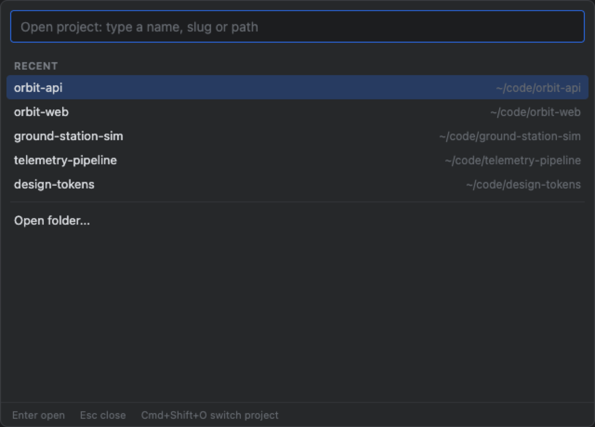

ARcode runs as a single instance. Starting it again (for example with `open -a`) forwards the
paths to the running app instead of starting a second copy.

## Window layout

| Area | Contents |
|---|---|
| Header | Project avatar, name and path (click to switch project), the activity lamp, current git branch, the **Claude** button, model picker, Remote Control button, running subagents, usage bars, IDE bridge status, and the **Gate** buttons. |
| Activity bar (far left) | Project files (Cmd+1), Search files (Cmd+P), Find in files (Cmd+Shift+F), Changes (Ctrl+Shift+G), Claude panel, Terminal (Cmd+2). |
| File tree | Left column. |
| Viewer | Right column, top. Tabs for the Claude feed, files, diffs and the Claude panel, left aligned and as wide as the column allows. |
| Discussion | A column on the right of the viewer with the voice discussion (see [Voice buttons](#voice-buttons-dictation-and-live-chat)). Drag its left edge to resize (260 to 640 px); › collapses it to a thin rail, and the rail or the discussion button brings it back. |
| Terminal dock | Right column, bottom. Shell, Claude and gate tabs. |

Drag the splitters to resize. Cmd+1 hides or shows the tree, Cmd+2 the terminal, and
Cmd+Shift+F12 hides all panels (press again to bring them back). Sizes and visibility, the discussion
column's width and whether it is collapsed included, are saved per project.

## File tree

The tree loads folders lazily, so large repositories open quickly. Entries ignored by
`.gitignore` are dimmed, changed files are colored by git status, and the tree follows changes on
disk.

- **Open:** click a file, or select it and press Enter. Arrow keys move, Right/Left expand and
  collapse, Home/End/PageUp/PageDown jump, Shift extends the selection. Cmd+click and Shift+click
  select several rows.
- **Header buttons:** "Select opened file" reveals the active viewer file; "Collapse all".
- **Context menu:** New File, New Folder, Import from Mac... (on folders), Paste files, Copy,
  Reveal in Finder, Copy Path, Copy Relative Path, Rename (F2), Delete (Backspace or Delete).
- **Delete** moves items to the macOS Trash after a confirmation.
- **Copy and paste with Finder:** Cmd+C on selected rows puts the files on the clipboard; Cmd+V
  pastes files copied in Finder into the selected folder. Name clashes get ` (2)`, ` (3)` suffixes,
  nothing is overwritten.
- **Drag and drop:** drop files from Finder onto a folder to copy them in. Drag rows into the
  terminal to type their paths.
- **Import from Mac:** a file browser limited to your home folder, with quick places for
  Screenshots, Downloads and Recent (newest files in Downloads, Desktop and Documents), sortable by
  name, size or date, with previews. Only files can be imported, not folders.
- **Go to file:** Cmd+P opens a fuzzy file search over the whole project. With nothing typed yet,
  the files you opened most recently come first.
- **Recent files:** Cmd+Shift+E opens the same palette with only the files you opened recently in
  this project (up to 30, newest first, files that no longer exist are left out). The file in front
  is not listed, so Cmd+Shift+E then Enter goes back to the previous file. Typing filters the list.

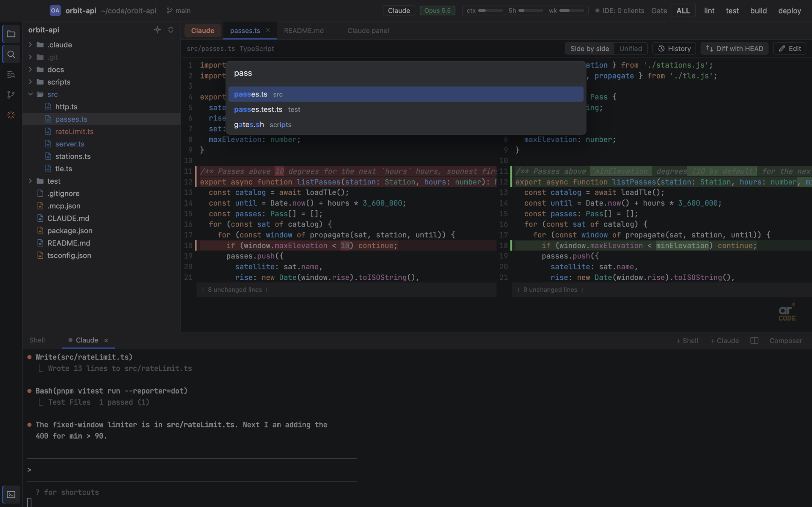

## Find in files

Cmd+Shift+F (or the Find in files button in the activity bar) switches the left column from the
file tree to a project-wide text search. Text selected in the editor on one line becomes the query.

- Results update as you type and are grouped by file, with the number of matches per file and the
  matched text highlighted. Click a file header to fold it.
- **Aa** matches case, **W** matches whole words, **.\*** treats the query as a regular expression.
- **File mask** limits the search: comma-separated globs such as `*.ts, src/**`; a leading `!`
  excludes (`!*.test.ts`). A glob without `/` matches the file name in any folder.
- Up and Down move through the matches, Enter or a click opens the file at that line and column.
  Esc returns to the file tree.
- Ignored files (`.gitignore`) and binary files are skipped. ARcode uses ripgrep when it is
  installed (`brew install ripgrep`), otherwise `git grep`, otherwise its own scan.
- Very large result sets stop at 2,000 matching lines and long lines are shortened around the match;
  the status line says when results are incomplete. A search stops after 10 seconds.

## Changes

Ctrl+Shift+G (or the Changes button in the activity bar) switches the left column to the list of
files that differ from the last commit, so you can review what a Claude turn changed without
hunting for files in the tree.

- Modified, added, deleted, renamed and untracked files are listed, grouped by folder. The letter
  on the right and the name colour match the tree: M modified, A added, D deleted, R renamed,
  U untracked, ! conflict. A renamed file shows where it came from.
- Each file shows the lines added and removed against HEAD (for an untracked file, its line
  count); the header shows the number of files and the totals.
- The list updates by itself while files change. The refresh button reruns git at once.
- Click a file or press Enter to open it with its diff against HEAD already shown (Side by side or
  Unified; the Diff with HEAD button hides it). A deleted file opens its HEAD version as a
  read-only diff.
- Up and Down move through the files, Esc returns to the file tree. "Open all diffs" (the button
  next to refresh) opens every changed file with its diff; with more than 20 files it asks first.
- Changes only shows what changed. Staging, committing and reverting stay in the terminal.
- In a folder that is not a git repository, the view says so.
- Cmd+Shift+G is not used for Changes because it is Find previous in the editor.

## File viewer

The viewer has tabs. The first tab, **Claude**, is the pinned [Claude feed](#claude-feed) and
cannot be closed. With no file open, the viewer shows its main shortcuts.

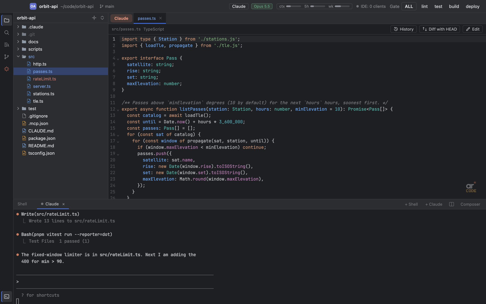

- **Read and edit:** files open read-only with syntax highlighting. Start typing to switch to edit
  mode (the character you typed goes in), or press **Cmd+E** (or the Edit button) to toggle it.
  If the file changed on disk since you opened it, saving asks whether to overwrite or reload. If
  it changes on disk while you have unsaved edits, a banner offers to reload or keep yours.
- **Autosave:** edits are saved about a second after you stop typing, when the window loses focus,
  when you switch to another tab, leave edit mode or close the tab. Claude Code reads files from
  disk, so it sees your edits without a manual save. The dot on the tab shows edits that are not
  on disk yet. Nothing is saved while a banner (changed on disk, conflict, deleted, save failed)
  waits for your decision. **Cmd+S** saves at once. Turn autosave off with **File > Autosave**;
  then Cmd+S saves and closing a tab with edits asks first.
- **Find and go to line:** Cmd+F searches in the file, Cmd+L goes to a line.
- **Duplicate:** in edit mode Cmd+D duplicates the current line, or repeats the selection right after it,
  as in JetBrains IDEs. Ctrl+G adds the next occurrence of the selection (multi-cursor), Cmd+click adds
  a cursor, Alt+drag selects a column, Cmd+Shift+Up/Down moves the line. Brackets and quotes close
  automatically.
- **Diff with HEAD:** shows the file against its last committed version, side by side or
  unified. A file that is not in HEAD is shown as entirely added.
- **Local history:** ARcode keeps its own copies of text files, independent of git, so you can get
  back a version from before Claude Code (or anything else) rewrote a file. A copy is kept before
  ARcode saves a file (at most one every 5 minutes while autosave runs, unless the change is large),
  and whenever a file in the project changes on disk from outside ARcode, for example when Claude
  Code edits it, whether or not it is open (the content it had before is kept, also when the file is
  deleted). For a file that is not open and that ARcode has not seen change before, the version
  kept is its last committed one (HEAD). Changes in gitignored files are not kept, a file changing
  again within 10 seconds keeps only one version, and a change of more than 100 files at once (a
  checkout or a rebase) keeps nothing. **History** in the file header lists the versions with their age
  and why they were kept ("before save" or "changed outside"). Pick one to see it side by side with
  the current file, then **Restore this version** writes it back after a confirmation; the content
  it replaces is kept as a new version, and unsaved edits are saved first. Only text files up to
  1 MB inside the project are kept, at most 50 versions per file, for 14 days.
- **Markdown:** `.md` files open in a rendered preview with a Preview / Split / Source switch. Relative
  links open in the viewer; relative images are loaded from the project. Remote images are not
  loaded. **Split** puts the editor on the left and a live preview on the right that follows your
  typing (autosave works as in Source). Drag the divider to resize. Scrolling either side scrolls
  the other to the matching block, approximately. When the viewer is narrower than about 900 px
  the preview moves under the editor instead. The mode you pick is remembered per file type
  (`.md`, `.markdown`, `.mdx`) for files you open next.
- **SVG:** switch between Image and Source.
- **Images:** zoom with Cmd+= and Cmd+- (or pinch, or Cmd+scroll), Cmd+0 or Shift+1 to fit,
  Shift+0 for actual size. Hold Space and drag to pan, or Shift+drag (or the zoom-to-selection
  button) to zoom into a rectangle.
- **PDF:** `.pdf` files open read-only in a PDF tab, whether you open them from the tree, Go to
  file, a path in the terminal or the Claude feed, or with `open -a ARcode file.pdf`. The built-in
  PDF viewer has page navigation, zoom, fit to page, rotation,
  thumbnails and scrolling. When the file changes on disk (for example, Claude regenerates it), the
  tab reloads; it returns to the first page. When `foo.md` sits next to `foo.pdf`, **Open Markdown
  source** opens it. **Open in default app** hands the file to Preview or your PDF app. Links in
  a PDF open in your default browser. Only PDFs inside an open project are shown.
- **Binary and large files:** binary files and files over the size limits (5 MB for text, 30 MB
  for images) show a placeholder with Reveal in Finder.
- **Tabs:** Cmd+W closes the active tab, Cmd+Shift+T reopens the last closed one,
  Cmd+Shift+] and Cmd+Shift+[ step between tabs. The window header shows the current git branch.
  Open file tabs and the active one are remembered per project and reopened the next time the
  project opens, behind the pinned Claude tab. Files deleted in the meantime are skipped; diff
  tabs and the Claude panel are not restored.

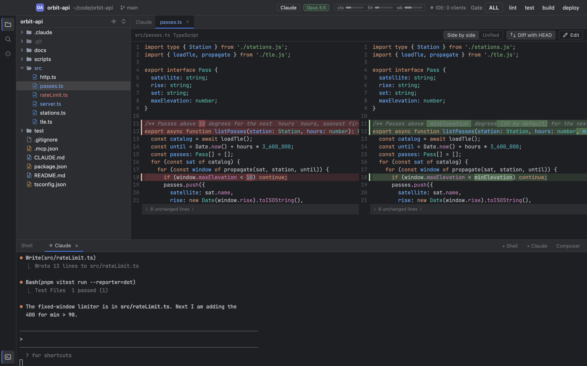

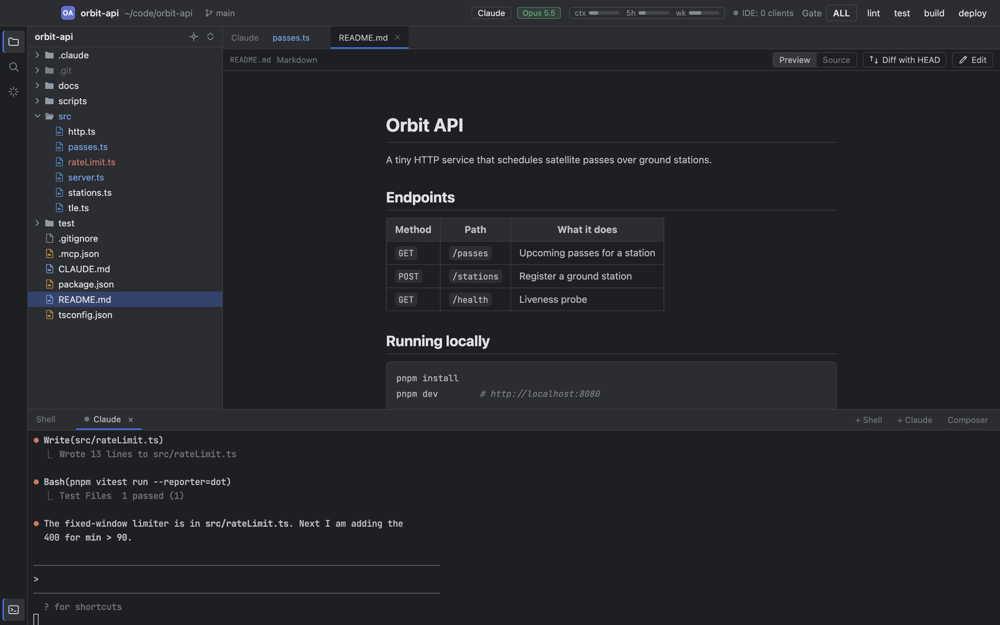

## Terminal

The dock at the bottom holds terminal tabs. Each tab is a login shell (your `$SHELL -l`) started in
the project folder.

| Tab type | How to open | What it is |
|---|---|---|
| Shell | Cmd+T or **+ Shell** | A plain login shell. |
| Claude | Ctrl+Esc or **+ Claude** | A shell that starts `claude` with a fresh session id. |
| Gate | **Gate** menu in the dock, or the header Gate buttons | A shell that runs `scripts/gates.sh <target>` and marks the tab with a check or a cross when it finishes. |

Other features:

- **Rename** a tab by double-clicking it. Middle-click closes a tab. Right-click a tab for Move to
  Other Side, Rename and Close Tab.
- **Split terminal** (Cmd+\, the split button next to **+ Claude**, or Terminal > Split Right):
  opens a shell in a second column on the right, so Claude can run on the left and a shell or a gate
  on the right. Each column has its own tab strip and active tab; drag the divider between them to
  resize. Right-click a tab and pick **Move to Other Side** to move it between columns (it keeps
  running). Closing the last tab of a column goes back to one column. When the dock is already
  split, Cmd+\ moves focus to the other column.
- **Focused column:** click a column to focus it; its strip shows a thin accent line on top. New
  tabs (Cmd+T, Ctrl+Esc, the header Gate buttons), Cmd+W, Cmd+Shift+] / [, Cmd+F, the composer and
  paste act on the active tab of the focused column. The **+ Shell** and **+ Claude** buttons add
  to their own column. Jumping to a waiting tab and clicking a notification select the tab in
  whichever column it sits.
- **File links:** paths in the output, such as `src/app.ts:42` or Claude Code's `Read(src/app.ts)`,
  are clickable and open the file at that line in the viewer. Web links open in your browser.
- **Composer** (Cmd+Shift+Enter): a multi-line text box under the terminal. Cmd+Enter sends the
  text to the active tab, Up/Down recall earlier entries of this project, Ctrl+R searches them
  (type words, Up/Down or Ctrl+R to move, Enter to take one), Esc returns to the terminal.
- **New lines** inside Claude Code's prompt: Shift+Enter or Option+Enter.
- **Search** (Cmd+F): Enter for next, Shift+Enter for previous, Esc to close, with a match case
  toggle.
- **Pasting:** Cmd+V pastes text. Files copied in Finder or in the tree are typed as shell-escaped
  paths. An image on the clipboard is passed to the program as Ctrl+V, so Claude Code attaches it
  itself.
- **Pasted images in the composer** are saved as files under ARcode's data folder and their path is
  inserted. These files are deleted after seven days.
- **Dropped files** from Finder or the tree type their shell-escaped paths.
- **Font size:** Cmd+= / Cmd+- / Cmd+0.
- **Clear:** Cmd+K. Cmd+C copies when text is selected and sends Ctrl+C otherwise.
- **Status dot:** each tab shows whether its Claude session is working or waiting for you; the
  tooltip says what it waits for. A tab that waits for you gets a pulsing coral dot and a coral
  title until you answer.
- **Jump to a waiting tab** (Cmd+Shift+J, or Terminal > Jump to Waiting Claude Tab): selects the
  next tab of this window where Claude waits for you, showing the terminal if it is hidden. Press it
  again to cycle through all waiting tabs. When none waits, a short hint says so.
- **Restore after restart:** tabs, their names, the split (which tabs sit on which side and the
  divider position) and the composer state are saved per project. Gate tabs are not saved, so a
  column that held only gates comes back as one column. After
  a restart, shell tabs start fresh shells; a Claude tab whose session has a transcript asks
  whether to **Continue previous session** (`claude --resume <id>`) or start a **New session**.

Terminals do not inherit Anthropic API keys, provider switches (Bedrock, Vertex and similar) or the
markers of a parent Claude Code session from the environment ARcode was launched in, so `claude`
inside ARcode uses your normal subscription login and starts as a top-level session.

## Voice input

Dictate a prompt into the composer instead of typing it. Speech is recognised on your Mac with
[whisper.cpp](https://github.com/ggml-org/whisper.cpp); the audio never leaves the computer.

- **Use:** click the microphone button next to **Send** (or press Cmd+Shift+M in the composer).
  The button turns red and counts the seconds. Click it again (or Cmd+Shift+M) to stop; after
  "Transcribing..." the text is inserted at the caret, ready to edit and send. Esc while recording
  discards it. A recording stops by itself after 5 minutes.
- **Microphone access:** macOS asks once. If you declined, allow ARcode in System Settings >
  Privacy & Security > Microphone.
- **Requirements:** `whisper-cli` (`brew install whisper-cpp`) and a ggml model, for example
  `ggml-large-v3-turbo-q5_0.bin` from the whisper.cpp models on Hugging Face, placed in
  `~/models/whisper` (or `~/Library/Application Support/ARcode/whisper`). When several models are
  there, one with `large-v3-turbo` in its name wins, then the largest.
- **Language:** Russian by default. Set `ARCODE_WHISPER_LANG` (for example `en`, or `auto` to
  detect) in the environment ARcode is started from to change it.
- **Other settings:** `ARCODE_WHISPER_CLI` points to a specific `whisper-cli`, `ARCODE_WHISPER_MODEL`
  to a specific model file.
- **Errors** show as a short line under the composer with the fix (install whisper.cpp, add a
  model, allow the microphone). Transcription gives up after 2 minutes.

### Voice buttons: dictation and live chat

Two buttons use the microphone; only one listens at a time (turning one on turns the other off), and
both only listen while ARcode is the active window, so speech around you while you are in another
app never reaches Claude (a phrase you were in the middle of when you switched still goes out). A
pause of about 1.5 seconds ends a phrase, which is recognised locally.

**Dictation** sits in the bottom right corner of the terminal, next to Claude's prompt. Click it (or
press Cmd+Shift+D) to turn it on and off; the small mark on its corner (or a right click) picks the mode,
which is remembered:

- **Type into the prompt** types each phrase into Claude's prompt without pressing Enter, joined with
  spaces. Keep talking to add more, edit with the keyboard, and press Enter yourself.
- **Send each phrase** sends each phrase with Enter as soon as you pause.

**Discussion** lives in its own column on the right of the viewer, and its floating button with a
waveform icon turns the voice on and off. The button starts just above the arCode mark in the bottom
right corner of the viewer; drag it anywhere and it stays there. Turning it on (or Cmd+Shift+Space)
also expands the column when it is collapsed.
Click it (or press Cmd+Shift+Space) and talk about the work in your Claude Code session, the way you
would in a voice chat: why it did something, which option is better, what to do next. The partner
is a separate, fast conversation with Claude that knows what you are doing in the Claude Code tab and
may read project files, but never writes, edits or runs anything and never types into Claude Code.
With each message ARcode gives it a short brief of the session: your latest prompts, Claude Code's
latest message, its todo list, recent errors with the end of their output, the files it changed and
your earlier prompts, and after the first message only what changed. When you ask about something the
brief leaves out (a failed test run, a long log, what Claude Code did an hour ago, a subagent's
report), the partner looks it up in the session itself through ARcode's local lookup tools: one turn
in full, the whole output of a command in pages, a search through the session. Nothing of the session
is copied anywhere for this; the lookups read Claude Code's own transcript on demand, and only the
session of this window's Claude tab. Switch tabs and the partner gets the brief of the other session.
Big documents work too: ask it to debrief a large file in the project and it reads the file in parts
before answering. A message you type or paste is sent whole (up to 150,000 characters; a longer one
is refused with a note, save it as a file in the project instead). Its answers stream into the
column and are read aloud sentence by sentence, without code; until the first words arrive (and in a
longer pause, while it reads a file) a small coral spark shows it is thinking. You can also type in the line at the
bottom of the column.

- **Handing over:** say so ("pass it to Claude Code", or "yes" when the partner offers), or click
  **→ Claude Code**. The partner says it is handing over and writes the task; ARcode sends it to the
  Claude tab at once: pasted in one piece (Claude Code shows a long paste as "[Pasted text]"), then
  submitted as soon as Claude Code has taken the paste, so it starts right away. The task shows under
  the answer marked **Sent to Claude Code** and is not read aloud. When Claude Code is busy, the task
  goes into its message queue like text you type while it works (marked **Queued in Claude Code**, and
  muted in the feed until Claude takes it). When Claude Code asks something, is not running in the tab,
  or has text you typed and not sent in its prompt, the task is not sent: it stays under the answer
  with the reason and a **Send** button.
- **New** starts a fresh discussion. **■ Stop** (in the bubble and the column's header), a click on
  the button, or talking over it stops a reading. The speaker switch in the column's header turns
  reading aloud off (remembered).
- The partner runs on your own Claude Code login and subscription (`claude -p` in the background, one
  per window; `ARCODE_CLAUDE` picks the executable). It loads no MCP servers of yours, only ARcode's
  own lookup server (on 127.0.0.1, with a token per window), and keeps no session on disk. The
  **Sonnet / Opus** switch in the column's header picks its model (Sonnet by default, remembered);
  switching keeps the conversation going on the other model, with a note in the column. If the
  partner ever has to start again, ARcode gives it the brief and your last exchanges, so it picks up
  where you were.
- While ElevenLabs reads, a ring around the button shows the plan's character allowance: a faint
  track fills with blue from the top, clockwise, as characters are used; the tooltip and the voice
  menu give the numbers and the reset date. A reading you stop has already been paid for the piece
  being read and the one rendered ahead (about 800 characters at most); answers still waiting are not.
- **History:** every discussion is saved in the project, one Markdown file per conversation in
  `.arcode/discussions/`, named by when it started (`2026-11-13_14-05.md`; New starts a new file). The file starts with the date, the project and the model, then lists what you
  said (**Ты**) and the partner's answers (**Собеседник**) with their times, each handed-over task as
  a quoted block with its status (**Sent to Claude Code** or why not), later Send results, notes and
  errors. It is appended to as the conversation goes. The session briefs sent to the partner are not
  kept (Claude Code's own transcripts have them). Because a discussion can hold sensitive things,
  ARcode adds `.arcode/` to the repository's local `.git/info/exclude`, never to a committed file, so
  the history stays out of git. If a file cannot be written, the discussion goes on and the column
  says so once.

- **While Claude works (dictation):** phrases still go out, like typed messages: Claude Code queues
  them (they show as queued in the feed). Only a question Claude asks in the terminal (a permission, a choice)
  pauses listening, since anything typed would become its answer; answer those in the terminal or
  in the feed.
- **Which tab:** the active terminal tab when it runs Claude, otherwise the last Claude tab.
- **What you see:** the ring around a button follows your voice; the bubble next to it shows the
  mode, the state and, for a few seconds, the phrase that was sent.
- Stock phrases whisper invents on silence ("Thanks for watching" and its Russian versions) are
  dropped. Requirements and settings for recognition are the same as for voice input above.

#### Reading answers aloud

The discussion's voice menu picks who reads, and with which voice:

| Engine | Where it runs | Set up |
|---|---|---|
| **ElevenLabs** | ElevenLabs' cloud. Only the code-free answer text is sent; your voice and your phrases never are. ElevenLabs keeps what it receives under its own policy, so do not use it for sensitive projects. While it reads, the button shows the ring with your plan's allowance. | An API key in the macOS Keychain: `security add-generic-password -U -s "ARcode ElevenLabs" -a api-key -w` (you are asked for the key), or `ELEVENLABS_API_KEY`. The voices of your ElevenLabs account are offered. `ARCODE_ELEVENLABS_MODEL` changes the model (default `eleven_multilingual_v2`). |
| **Silero** | On this Mac, a neural Russian voice. | A Python environment with Silero in `~/models/silero/.venv` (`uv venv ~/models/silero/.venv && uv pip install --python ~/models/silero/.venv/bin/python silero torch scipy omegaconf`), or `ARCODE_SILERO_PYTHON`. The model is downloaded once on first use. Silero's models are licensed for non-commercial use. |
| **macOS voice** | On this Mac (`say`). | Nothing; the voice follows the dictation language (`ARCODE_TTS_VOICE` picks another). |

Without a pick, ElevenLabs is used when its key is set up, else Silero, else the macOS voice.

## Claude Code integration

### IDE bridge without /ide

Every project window runs the same local bridge an IDE extension would: a WebSocket server on
127.0.0.1 with a random token and a lock file in `~/.claude/ide`. Terminals get
`CLAUDE_CODE_SSE_PORT`, so `claude` started in ARcode connects at once; there is no need to run
`/ide`. The header shows the bridge status ("IDE: N clients").

What it gives you:

- **Diff review:** when Claude Code proposes an edit, a diff tab opens in the viewer with
  Accept and Reject buttons. Claude Code waits for your choice.
- **Open file:** Claude Code can open files in the viewer.
- **Selection sharing:** the active file and selection in the viewer are reported to Claude Code.
- **@-mention:** Cmd+Option+K in the viewer sends the current file (and the selected lines) to
  Claude Code as an @-mention.

### What the header shows

| Item | Source | When it shows |
|---|---|---|
| Activity lamp (next to the project name) | Claude status of every tab plus the processes running in each terminal | Always. Blinking orange while anything runs: Claude working, a command in a shell tab, a gate, or a shell command Claude left running in the background. Steady orange when nothing runs but Claude waits for you. Green when everything is done. Click it for the list; a row shows its tab. |
| Model badge (for example "Opus 5.5") | The active Claude tab's session transcript | While a Claude tab is active. Click it to pick another model (Fable, Opus, Sonnet, Haiku or the account default): ARcode types `/model <id>` into that tab. Only while Claude waits at an empty prompt, so the command never lands as a message or as an answer. |
| **RC** button | `bridgeSessionId` in Claude Code's process registry | While a Claude tab is active. A click types `/remote-control` into the tab. `RC…` while it starts (answer in the terminal if Claude asks to confirm), **RC on** once Claude Code reports the Remote Control session, with **Open in browser** and **Copy link** for `claude.ai/code/<session>`, and **RC failed** when no session shows up within 30 seconds. While it is on, the menu has **Disconnect**, which types `/remote-control` again (Claude Code's own toggle); the button shows `RC…` until the session is gone and reports it when it stays up. |
| Subagents chip | Subagent transcripts of the active session | While subagents are running; the tooltip lists name, model and age. Click it for a list with **Open transcript** per agent. |
| Usage bars `ctx`, `5h`, `wk`, `Fable`... | The opt-in status line, and a plan usage check every 5 minutes | Context fill (status line, once a reply has arrived), 5-hour and weekly plan usage, and the weekly window of each model the plan limits on its own (Fable, and Opus or Sonnet where the plan has them). The plan figures come from a short `claude` run every 5 minutes that asks Claude Code for the plan's usage: it calls no model, spends no tokens, runs no hooks and leaves nothing in the session history. A window the plan does not have is not shown. |
| IDE indicator | The bridge | Number of connected Claude Code clients. |

### Status line (opt-in)

Plan percentages are only available inside Claude Code's status line input. To see them, open the
Claude panel, go to **Usage** and click **Status line: off**. ARcode then:

1. Copies its script to `~/Library/Application Support/ARcode/arcode-statusline.py`.
2. Saves a backup of your current settings as `~/.claude/settings.json.bak-arcode-<timestamp>`.
3. Sets exactly this entry in `~/.claude/settings.json` (written atomically; a symlinked settings
   file stays a symlink):

   ```json
   "statusLine": {
     "type": "command",
     "command": "python3 \"/Users/<you>/Library/Application Support/ARcode/arcode-statusline.py\""
   }
   ```

ARcode refuses to do this if another status line is already configured, or if `settings.json` is
not valid JSON. Clicking **Status line: on** removes only ARcode's own entry (again with a backup).

The script runs with the system `python3`, writes one small JSON record per session to
`~/Library/Application Support/ARcode/usage/` (model, context, cost, rate limits) and prints a
status line inside Claude Code with a summary and the running subagents. It always exits 0, so it
cannot break Claude Code. Records older than seven days are pruned.

## Claude feed

The pinned **Claude** tab in the viewer shows the active Claude tab's session (or the last one this
window showed) as a readable conversation, live. A `claude` you start by hand counts too: quitting
Claude Code and running it again in the same tab moves the feed to the new session, and a shell
tab you run `claude` in becomes a Claude tab. Messages you send while
Claude is busy show at the bottom right away, muted and marked **Queued**; once Claude takes one
it moves into the conversation as usual.

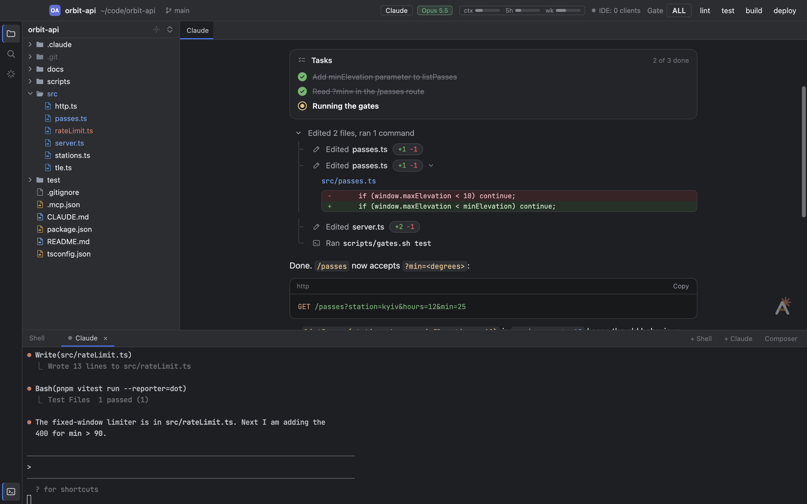

- Your prompts and Claude's answers are rendered as Markdown with highlighted code; file references
  are links that open in the viewer. Line breaks show as in the terminal, numbered lines and `•`
  bullets read as lists, long paths and links wrap, and wide tables scroll sideways in their own box.
- Tool calls are short rows that expand into diffs, command output and other details.
- Task lists, agent runs, questions and plans appear as cards.
- A working indicator shows the current step, or what Claude is waiting for.
- **Answer from the feed.** While Claude waits on a question, a plan or a permission in a Claude
  tab of this window, the card's options are buttons. A single question with one choice is sent
  with one click; otherwise pick an answer per question and press **Send answers**. Single-choice
  questions also take a typed answer. Plan approvals and permissions show the options the terminal
  shows; options that need text (feedback for Claude) pick the option and move you to the terminal
  to type it. ARcode types the same keys you would, so the terminal shows the result as usual.
  Typed answers to multi-choice questions, or a prompt you already started answering in the
  terminal, are left to the terminal: **Open terminal** takes you there.
- Thinking, system reminders, hook records and similar noise are hidden.
- **Load earlier messages** at the top reads further back. Each message has a copy button; image
  attachments show as thumbnails you can enlarge.
- **Cost and time per turn.** Under each finished turn a muted chip such as
  `12.4k in · 1.1k out · 38 s` shows the tokens of the turn's API calls and the time from your
  prompt to Claude's last reply. "in" counts input that was not read from the prompt cache (fresh
  input plus tokens written to the cache); hover the chip for the cache split and the number of
  calls. A thin strip at the top of the feed sums the loaded part of the transcript
  ("(loaded)" when earlier messages are not loaded yet).
- **Agent cards** have **Open transcript**, which opens the subagent's own conversation in a tab of
  its own. It updates live while the agent runs.

**Read-only feed tabs.** **Open** next to a session in the Claude panel (Sessions, or Recent
sessions on the Overview) opens that session in a closable viewer tab titled by the session's name.
These tabs, and subagent transcript tabs, are marked "Read-only" and never offer anything that would
answer Claude; they keep updating while the session or agent is still running. The pinned **Claude**
tab stays first and keeps following the active Claude tab.

The feed only reads the session transcript under `~/.claude/projects`; it never writes to it.
Answers go to the Claude tab's terminal as key presses, never into Claude Code's files.

## Claude panel

Click **Claude** in the header (or the activity bar) to open the panel as a viewer tab. It is a
read-only view of Claude Code's configuration for this project, except for the status line switch.
Sections are listed on the left with their item counts (when the viewer is narrow they move into
a row of tabs at the top); a red dot marks a section with a problem. The panel remembers the last
section you opened. The reload button at the top right reads everything from disk again.

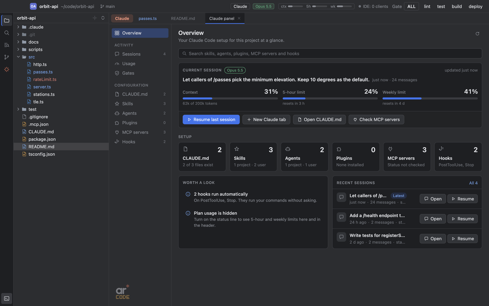

**Overview** is the first section:

- **Current session:** the newest session's first prompt, its model, and bars for context fill,
  the 5-hour limit, the weekly limit and each per-model weekly limit (Fable...) with the time until
  each resets (plan figures need the
  [status line](#status-line-opt-in)).
- **Quick actions:** Resume last session, New Claude tab, Open CLAUDE.md (or, when the project has
  none, a pointer to `/init`) and Check MCP servers.
- **Setup:** one tile per kind (CLAUDE.md, skills, agents, plugins, MCP servers, hooks) with a
  count and a short summary such as "1 project · 2 user". The MCP tile turns red when a server
  fails. Click a tile to open its section.
- **Worth a look:** failing MCP servers and servers that need sign-in, a missing project
  CLAUDE.md, hooks that run automatically, and plan usage that is hidden because the status line
  is off. Click an entry to go to its section.
- **Recent sessions** with Open and Resume buttons.
- **Search** at the top looks through skills, agents, plugins, MCP servers and hooks at once.

| Section | What it shows |
|---|---|
| Sessions | Past Claude Code sessions of this project, grouped into Today, Yesterday, Earlier this week and Older. Each is titled by the name Claude Code saved for it (a `/rename`, else the title Claude Code generated, else an older summary record) or else its first prompt, with relative age, message count and start time. **Open** reads it in a read-only viewer tab, **Resume** continues it in a new terminal tab; the copy button copies its session id. |
| Usage | Live 5-hour, weekly, per-model weekly (Fable...) and context usage as bars (with the status line on), the status line switch, and token counts for the current session, today and the last 7 days, read from transcripts. Refreshes every 30 seconds. |
| Gates | What each gate runs and, for projects with a `src/main`, `src/preload`, `src/shared` or `src/renderer/src` folder, an approximate count of tests per area. |
| CLAUDE.md | The global, project and local CLAUDE.md files, with line counts and their text. Files that do not exist say what they are for and how to create them. Project files open in the viewer for editing. |
| Skills | User, project and plugin skills, grouped by scope. |
| Agents | Custom subagents with their model and description. |
| Plugins | Installed plugins, enabled or disabled, with marketplace, version and install age. |
| MCP servers | Servers from your settings and `.mcp.json`, listed at once with "Not checked". **Check status** runs `claude mcp list` (a few seconds), marks each server Connected, Needs auth or Failed, adds servers from plugins and claude.ai, and shows a summary line. |
| Hooks | Hooks from `~/.claude/settings.json`, `.claude/settings.json` and `.claude/settings.local.json`, with event, matcher, command and the file they come from. |

In the item lists every row shows a readable name, a one-line description and the file it comes
from; on hover a button copies the path. Clicking a row opens its file in the viewer when the file
is inside the project. Files outside the project (for example skills and agents in `~/.claude`)
cannot be opened in the viewer, so the row expands into a read-only preview instead. Each list has
a filter box (Esc clears it). An empty section explains what the feature is and where its files
go, for example `~/.claude/skills/<name>/SKILL.md` for skills.

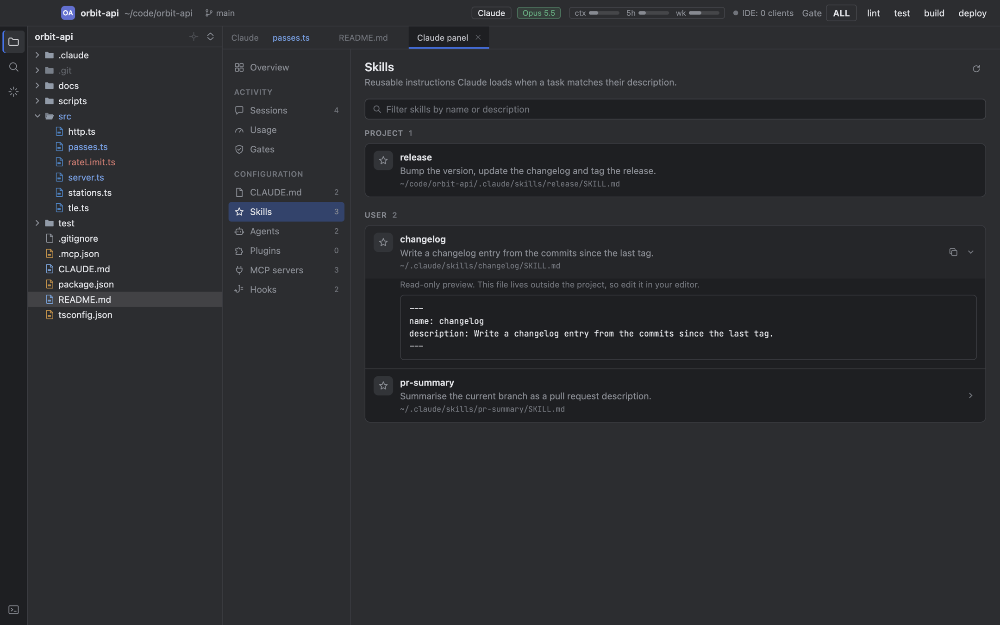

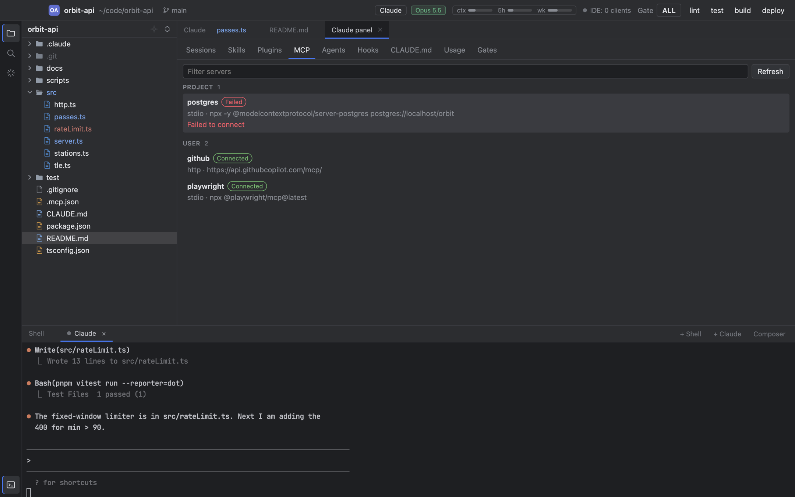

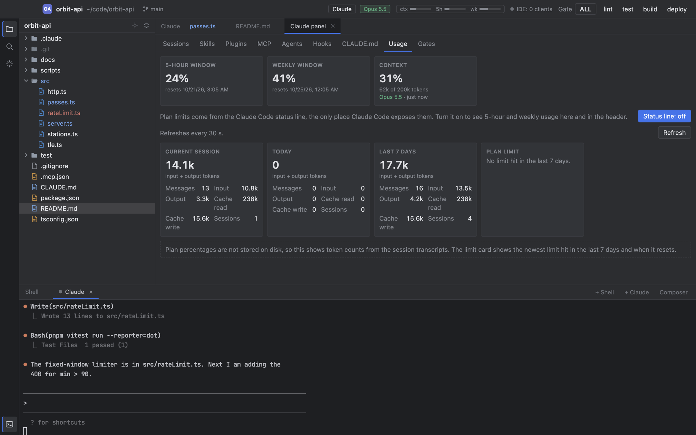

## Quality gates

The header's **Gate** buttons (ALL, lint, test, build, deploy) run `scripts/gates.sh <target>` in a
new terminal tab of the open project. The tab shows a check or a cross when the script exits.

This is a convention, not something tied to ARcode's own code: any project can adopt it by adding an
executable `scripts/gates.sh` that accepts `all`, `lint`, `test`, `build` and `deploy` and exits
non-zero on failure. ARcode's own [`scripts/gates.sh`](../scripts/gates.sh) is a working example
(ESLint and TypeScript, Vitest, a production build, and a `deploy` target that is only a preflight).

The **Gates** section of the Claude panel describes each target in plain words and lists the
`package.json` scripts it would call, flagging missing ones. Gate results are not stored anywhere:
each run stays in its terminal tab.

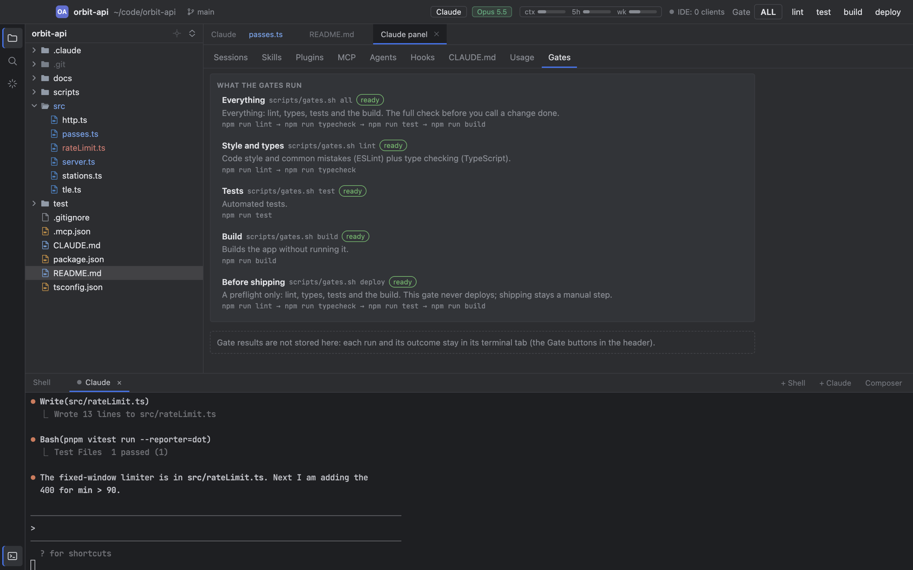

## Notifications and dock badge

When a Claude session in one of a window's terminals starts waiting for you (a permission prompt,
a question, the end of a turn) and that window is not focused, ARcode shows one macOS notification
per waiting period. The notification is titled with the project name, names the terminal tab and
says what Claude is waiting for, so several waiting sessions stay apart in Notification Center.
Clicking it brings the window forward, shows the terminal if it is hidden and selects that exact tab.
The Dock icon shows a badge with the number of waiting tabs you are not looking at. Allow
notifications for ARcode in System Settings > Notifications if they do not appear.

Notifications play the macOS notification sound; uncheck Terminal > Notification Sound to make them
silent. The setting is saved in `state.json`.

## Project registry (optional)

The switcher can also list projects from a local SQLite database with a `projects` table
(`slug, name, status, kind, home`), where `home` starts with a folder path. Point ARcode at it with
the `ARCODE_PROJECT_REGISTRY_DB` environment variable, or set `settings.projectRegistryDb` in
`~/Library/Application Support/ARcode/state.json`. The database is read only, through the system
`sqlite3` command. Projects with status `active` or `validating` are listed first. Without a
database the switcher shows recent projects only.

## Keyboard shortcuts

### Global and windows

| Keys | Action |
|---|---|
| Cmd+Shift+O | Project switcher |
| Cmd+Shift+W | Close window |
| Cmd+1 | Show or hide the file tree |
| Cmd+2 | Show or hide the terminal |
| Cmd+Shift+F12 | Hide all panels / bring them back |
| Cmd+P | Go to file (works in the terminal too) |
| Cmd+Shift+F | Find in files (works in the terminal too; Esc returns to the tree) |
| Ctrl+Shift+G | Changes against HEAD (works in the terminal too; Esc returns to the tree) |
| Cmd+Shift+E | Recent files (works in the terminal too) |
| Ctrl+Esc | New Claude tab |
| Cmd+Shift+J | Jump to the next terminal tab where Claude waits for you (works in the terminal too) |
| Cmd+Shift+Space | Turn the discussion on or off |
| Cmd+Shift+D | Turn dictation into Claude's prompt on or off |
| Cmd+T | New shell tab |
| Cmd+\ | Split the terminal into two columns, or focus the other column when it is split |
| Cmd+W | Close the active tab (terminal or viewer, depending on focus) |
| Cmd+Shift+] / Cmd+Shift+[ | Next / previous tab (terminal or viewer, depending on focus) |

### Project switcher

| Keys | Action |
|---|---|
| Up / Down, Ctrl+P / Ctrl+N | Move |
| Enter | Open |
| Esc | Close |

### File tree

| Keys | Action |
|---|---|
| Up / Down | Move selection (with Shift: extend) |
| Right / Left | Expand / collapse, or go to parent |
| Home / End, PageUp / PageDown | Jump |
| Enter | Open file or toggle folder |
| F2 | Rename |
| Backspace / Delete | Move to Trash |
| Cmd+C / Cmd+V | Copy files / paste files from Finder |
| Cmd+click, Shift+click | Multi-select |

### Viewer

| Keys | Action |
|---|---|
| Cmd+E | Toggle edit mode (typing in read-only mode also starts editing) |
| Cmd+S | Save now (autosave saves on its own unless File > Autosave is off) |
| Cmd+F | Find in file |
| Cmd+L | Go to line |
| Cmd+D | Duplicate the line (or the selection), in edit mode |
| Ctrl+G | Add the next occurrence to the selection, in edit mode |
| Cmd+Shift+Up / Down | Move the line up / down, in edit mode |
| Alt+drag | Column (rectangular) selection |
| Cmd+Shift+T | Reopen closed tab |
| Cmd+Option+K | Send the file and selection to Claude Code as an @-mention |
| Tab / Shift+Tab | Indent / outdent while editing |

### Image viewer

| Keys | Action |
|---|---|
| Cmd+= / Cmd+- | Zoom in / out |
| Cmd+0, Shift+1 | Fit to window |
| Shift+0 | Actual size |
| Cmd+scroll, pinch | Zoom at the cursor |
| Space+drag | Pan |
| Shift+drag | Zoom to a rectangle |
| Esc | Leave zoom-to-selection mode |

### Terminal

| Keys | Action |
|---|---|
| Cmd+C | Copy selection, or send Ctrl+C when nothing is selected |
| Cmd+V | Paste text; copied files are typed as paths; an image is passed on as Ctrl+V |
| Cmd+K | Clear |
| Cmd+F | Search |
| Shift+Enter, Option+Enter | New line in Claude Code's prompt |
| Cmd+Shift+Enter | Toggle the composer |
| Cmd+= / Cmd+- / Cmd+0 | Font larger / smaller / reset |

### Terminal search and composer

| Keys | Action |
|---|---|
| Enter / Shift+Enter | Next / previous match |
| Esc | Close search |
| Cmd+Enter | Send the composer text |
| Cmd+Shift+M | Start / stop voice input |
| Esc (while recording) | Discard the recording |
| Up / Down (empty composer) | Previous / next composer entry |
| Esc | Back to the terminal |

## Where data lives

| Location | Contents |
|---|---|
| `~/Library/Application Support/ARcode/state.json` | Recent projects, open windows, window bounds, panel layout, terminal tabs, viewer tabs and recent files per project, settings (Autosave). |
| `~/Library/Application Support/ARcode/paste/` | Images pasted into the terminal composer; deleted after 7 days. |
| `~/Library/Application Support/ARcode/history/` | Local history: copies of project text files kept before saves and on outside changes, one folder per project (a hash of its path) and per file. Max 50 per file, deleted after 14 days. |
| `~/Library/Application Support/ARcode/usage/` | Status line records, one per session; pruned after 7 days. Only with the status line on. |
| `~/Library/Application Support/ARcode/arcode-statusline.py` | Installed status line script. Only with the status line on. |
| `~/.claude/ide/<port>.lock` | IDE bridge lock file per open window, removed when the window closes. |
| `~/.claude/settings.json` and `settings.json.bak-arcode-<timestamp>` | Changed only by the status line switch, with a backup. |
| `<project>/.arcode/discussions/` | Discussion history, one Markdown file per conversation; `.arcode/` is added to the repository's `.git/info/exclude`. |
| Browser storage of the app | Terminal font size, expanded tree folders, import dialog sort. |

To reset ARcode, quit it and delete `~/Library/Application Support/ARcode`.

## Privacy

ARcode has no account, no telemetry, no crash reporter and no auto-updater. It makes no network
requests of its own, except the opt-in ElevenLabs voice described below.

- **Network:** the only listener is the IDE bridge WebSocket on 127.0.0.1, protected by a random
  token. Remote images in Markdown are blocked by the page's Content Security Policy. PDF tabs are
  served by ARcode itself from the project folder; nothing is fetched from the network. Web links
  open in your default browser only when you click them.
- **What it reads:** your project files and git state, and Claude Code's local files:
  `~/.claude/projects` (transcripts), `~/.claude/sessions`, settings, plugins, skills, agents,
  `CLAUDE.md` files, `~/.claude.json`, the project's `.claude/` folder and `.mcp.json`.
- **What it writes:** the files listed in [Where data lives](#where-data-lives), plus project files
  you create, edit, import, paste, rename or trash yourself.
- **Programs it runs:** your login shell in each terminal; `git` (with `GIT_OPTIONAL_LOCKS=0`, so it
  never blocks your own git commands); `ps` and `pgrep` to match Claude processes to tabs and, every 1.5 seconds while terminals are
  open, to see what runs in them for the activity lamp;
  `defaults` to find your screenshots folder; `sqlite3` for the optional registry; `whisper-cli`
  for voice input, on a temporary audio file that is deleted right after; and
  `claude -p` for the discussion partner (only while you use it); `claude mcp list` only when you click the MCP check, which is Claude Code contacting the MCP
  servers you configured.

The one exception is opt-in: with an ElevenLabs key in the Keychain and ElevenLabs picked for
reading answers aloud, the text of Claude's answers (without code) is sent to ElevenLabs.

Whatever you run in a terminal, including Claude Code itself, talks to the network as usual.

## Troubleshooting

| Problem | Fix |
|---|---|
| "ARcode is damaged" or "cannot be opened" on first launch | Clear the quarantine flag: `xattr -dr com.apple.quarantine /Applications/ARcode.app`. |
| Terminal does not start, or an error mentions `node-pty` / `NODE_MODULE_VERSION` | The native module was built for another Electron version. Run `pnpm rebuild:native` and rebuild. |
| `pnpm dev` starts and quits at once | Another ARcode is running; the new instance forwards its arguments to it and exits. Quit the installed ARcode, or start the dev build with a different user data folder. |
| `scripts/install-app.sh` hangs or fails to replace the app | Run it from a terminal outside ARcode, or quit ARcode first. |
| No usage bars in the header | Turn on the status line in Claude panel > Usage, then wait for the next Claude reply. If another status line is configured, ARcode leaves it alone and shows no live percentages. |
| Claude Code does not connect to ARcode | Make sure `claude` was started in an ARcode terminal (it needs `CLAUDE_CODE_SSE_PORT`). Check the "IDE" indicator in the header. |
| No notifications | Allow notifications for ARcode in System Settings > Notifications. Notifications only appear when the window is not focused. |
| Gate tab says `scripts/gates.sh: No such file or directory` | The project has no gates script. Add one (see [Quality gates](#quality-gates)). |
