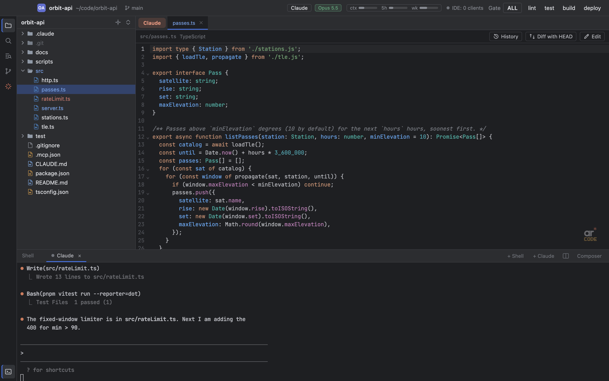

# ARcode user guide

ARcode is a small macOS workspace around terminal coding agents, mainly Claude Code. Each project
gets its own window with a file tree, a file viewer and a terminal dock. This guide covers
everyday use. For how the code is put together, see [ARCHITECTURE.md](ARCHITECTURE.md).


## Contents

- [Install](#install)
- [Open projects](#open-projects)
- [Window layout](#window-layout)
- [File tree](#file-tree)
- [File viewer](#file-viewer)
- [Terminal](#terminal)
- [Claude Code integration](#claude-code-integration)
- [Claude feed](#claude-feed)
- [Claude panel](#claude-panel)
- [Quality gates](#quality-gates)
- [Notifications and dock badge](#notifications-and-dock-badge)
- [Project registry (optional)](#project-registry-optional)
- [Keyboard shortcuts](#keyboard-shortcuts)
- [Where data lives](#where-data-lives)
- [Privacy](#privacy)
- [Troubleshooting](#troubleshooting)

## Install

ARcode is not distributed as a signed download. Build it from source on a Mac (Apple silicon or
Intel, macOS 12 or later):

Requirements: Node.js 22.12+, pnpm 10, Xcode Command Line Tools (`xcode-select --install`). The
native terminal module `node-pty` is compiled against Electron's headers during install.

```bash
git clone https://github.com/andrewrozumny/arcode.git
cd arcode
pnpm install
scripts/install-app.sh   # builds ARcode.app and copies it to /Applications
```

`scripts/install-app.sh` runs `pnpm dist`, quits a running ARcode and replaces
`/Applications/ARcode.app`. Run it from a terminal outside ARcode (or quit ARcode first), because it
cannot replace the instance you are typing in. To build without installing, run `pnpm dist`; the
app lands in `dist/mac-arm64/ARcode.app` (or `dist/mac/` on Intel).

The app is ad-hoc signed only and not notarized. If you copy the built app to another Mac,
clear the quarantine flag before the first launch, or Gatekeeper refuses to open it:

```bash
xattr -dr com.apple.quarantine /Applications/ARcode.app
```

## Open projects

A project is any folder. ARcode opens one window per project; opening a project that already has a
window focuses that window. Windows that were open when you quit are reopened at start.

| How | What happens |
|---|---|
| **Cmd+Shift+O** (File > Open Project...) or a click on the project name in the header | Opens the project switcher: recent projects plus, optionally, a project registry. Type to filter, arrows or Ctrl+N / Ctrl+P to move, Enter to open, Esc to close. |
| File > Open Folder... | Native folder picker. |
| File > Open Recent | The last 15 projects. |
| `open -a ARcode <folder>` | Opens or focuses that folder's window. |
| `open -a ARcode <file>` | Opens the file in the window whose project contains it; otherwise opens a window for the file's git repository, or for its folder. |


ARcode runs as a single instance. Starting it again (for example with `open -a`) forwards the
paths to the running app instead of starting a second copy.

## Window layout

| Area | Contents |
|---|---|
| Header | Project avatar, name and path (click to switch project), current git branch, the **Claude** button, model badge, running subagents, usage bars, IDE bridge status, and the **Gate** buttons. |
| Activity bar (far left) | Project files (Cmd+1), Search files (Cmd+P), Claude panel, Terminal (Cmd+2). |
| File tree | Left column. |
| Viewer | Right column, top. Tabs for the Claude feed, files, diffs and the Claude panel. |
| Terminal dock | Right column, bottom. Shell, Claude and gate tabs. |

Drag the splitters to resize. Cmd+1 hides or shows the tree, Cmd+2 the terminal, and
Cmd+Shift+F12 hides all panels (press again to bring them back). Sizes and visibility are saved per
project.

## File tree

The tree loads folders lazily, so large repositories open quickly. Entries ignored by
`.gitignore` are dimmed, changed files are colored by git status, and the tree follows changes on
disk.

- **Open:** click a file, or select it and press Enter. Arrow keys move, Right/Left expand and
  collapse, Home/End/PageUp/PageDown jump, Shift extends the selection. Cmd+click and Shift+click
  select several rows.
- **Header buttons:** "Select opened file" reveals the active viewer file; "Collapse all".
- **Context menu:** New File, New Folder, Import from Mac... (on folders), Paste files, Copy,
  Reveal in Finder, Copy Path, Copy Relative Path, Rename (F2), Delete (Backspace or Delete).
- **Delete** moves items to the macOS Trash after a confirmation.
- **Copy and paste with Finder:** Cmd+C on selected rows puts the files on the clipboard; Cmd+V
  pastes files copied in Finder into the selected folder. Name clashes get ` (2)`, ` (3)` suffixes,
  nothing is overwritten.
- **Drag and drop:** drop files from Finder onto a folder to copy them in. Drag rows into the
  terminal to type their paths.
- **Import from Mac:** a file browser limited to your home folder, with quick places for
  Screenshots, Downloads and Recent (newest files in Downloads, Desktop and Documents), sortable by
  name, size or date, with previews. Only files can be imported, not folders.
- **Go to file:** Cmd+P opens a fuzzy file search over the whole project.


## File viewer

The viewer has tabs. The first tab, **Claude**, is the pinned [Claude feed](#claude-feed) and
cannot be closed. With no file open, the viewer shows its main shortcuts.



- **Read and edit:** files open read-only with syntax highlighting. Press **Cmd+E** (or the Edit
  button) to edit and **Cmd+S** to save. If the file changed on disk since you opened it, saving
  asks whether to overwrite or reload. If it changes on disk while you have unsaved edits, a banner
  offers to reload or keep yours.
- **Find and go to line:** Cmd+F searches in the file, Cmd+L goes to a line.
- **Diff with HEAD:** shows the file against its last committed version, side by side or
  unified. A file that is not in HEAD is shown as entirely added.
- **Markdown:** `.md` files open in a rendered preview with a Preview / Source switch. Relative
  links open in the viewer; relative images are loaded from the project. Remote images are not
  loaded.
- **SVG:** switch between Image and Source.
- **Images:** zoom with Cmd+= and Cmd+- (or pinch, or Cmd+scroll), Cmd+0 or Shift+1 to fit,
  Shift+0 for actual size. Hold Space and drag to pan, or Shift+drag (or the zoom-to-selection
  button) to zoom into a rectangle.
- **Binary and large files:** binary files and files over the size limits (5 MB for text, 30 MB
  for images) show a placeholder with Reveal in Finder.
- **Tabs:** Cmd+W closes the active tab, Cmd+Shift+T reopens the last closed one,
  Cmd+Shift+] and Cmd+Shift+[ step between tabs. The window header shows the current git branch.


## Terminal

The dock at the bottom holds terminal tabs. Each tab is a login shell (your `$SHELL -l`) started in
the project folder.

| Tab type | How to open | What it is |
|---|---|---|
| Shell | Cmd+T or **+ Shell** | A plain login shell. |
| Claude | Ctrl+Esc or **+ Claude** | A shell that starts `claude` with a fresh session id. |
| Gate | **Gate** menu in the dock, or the header Gate buttons | A shell that runs `scripts/gates.sh <target>` and marks the tab with a check or a cross when it finishes. |

Other features:

- **Rename** a tab by double-clicking it. Middle-click closes a tab.
- **File links:** paths in the output, such as `src/app.ts:42` or Claude Code's `Read(src/app.ts)`,
  are clickable and open the file at that line in the viewer. Web links open in your browser.
- **Composer** (Cmd+Shift+Enter): a multi-line text box under the terminal. Cmd+Enter sends the
  text to the active tab, Up/Down recall earlier entries, Esc returns to the terminal.
- **New lines** inside Claude Code's prompt: Shift+Enter or Option+Enter.
- **Search** (Cmd+F): Enter for next, Shift+Enter for previous, Esc to close, with a match case
  toggle.
- **Pasting:** Cmd+V pastes text. Files copied in Finder or in the tree are typed as shell-escaped
  paths. An image on the clipboard is passed to the program as Ctrl+V, so Claude Code attaches it
  itself.
- **Pasted images in the composer** are saved as files under ARcode's data folder and their path is
  inserted. These files are deleted after seven days.
- **Dropped files** from Finder or the tree type their shell-escaped paths.
- **Font size:** Cmd+= / Cmd+- / Cmd+0.
- **Clear:** Cmd+K. Cmd+C copies when text is selected and sends Ctrl+C otherwise.
- **Status dot:** each tab shows whether its Claude session is working or waiting for you; the
  tooltip says what it waits for.
- **Restore after restart:** tabs, their names and the composer state are saved per project. After
  a restart, shell tabs start fresh shells; a Claude tab whose session has a transcript asks
  whether to **Continue previous session** (`claude --resume <id>`) or start a **New session**.

Terminals do not inherit Anthropic API keys, provider switches (Bedrock, Vertex and similar) or the
markers of a parent Claude Code session from the environment ARcode was launched in, so `claude`
inside ARcode uses your normal subscription login and starts as a top-level session.

## Claude Code integration

### IDE bridge without /ide

Every project window runs the same local bridge an IDE extension would: a WebSocket server on
127.0.0.1 with a random token and a lock file in `~/.claude/ide`. Terminals get
`CLAUDE_CODE_SSE_PORT`, so `claude` started in ARcode connects at once; there is no need to run
`/ide`. The header shows the bridge status ("IDE: N clients").

What it gives you:

- **Diff review:** when Claude Code proposes an edit, a diff tab opens in the viewer with
  Accept and Reject buttons. Claude Code waits for your choice.
- **Open file:** Claude Code can open files in the viewer.
- **Selection sharing:** the active file and selection in the viewer are reported to Claude Code.
- **@-mention:** Cmd+Option+K in the viewer sends the current file (and the selected lines) to
  Claude Code as an @-mention.

### What the header shows

| Item | Source | When it shows |
|---|---|---|
| Model badge (for example "Opus 5.5") | The active Claude tab's session transcript | While a Claude tab is active. |
| Subagents chip | Subagent transcripts of the active session | While subagents are running; the tooltip lists name, model and age. |
| Usage bars `ctx`, `5h`, `wk` | The opt-in status line | Context fill, 5-hour and weekly plan usage, once the status line is on and a reply has arrived. |
| IDE indicator | The bridge | Number of connected Claude Code clients. |

### Status line (opt-in)

Plan percentages are only available inside Claude Code's status line input. To see them, open the
Claude panel, go to **Usage** and click **Status line: off**. ARcode then:

1. Copies its script to `~/Library/Application Support/ARcode/arcode-statusline.py`.
2. Saves a backup of your current settings as `~/.claude/settings.json.bak-arcode-<timestamp>`.
3. Sets exactly this entry in `~/.claude/settings.json` (written atomically; a symlinked settings
   file stays a symlink):

   ```json
   "statusLine": {
     "type": "command",
     "command": "python3 \"/Users/<you>/Library/Application Support/ARcode/arcode-statusline.py\""
   }
   ```

ARcode refuses to do this if another status line is already configured, or if `settings.json` is
not valid JSON. Clicking **Status line: on** removes only ARcode's own entry (again with a backup).

The script runs with the system `python3`, writes one small JSON record per session to
`~/Library/Application Support/ARcode/usage/` (model, context, cost, rate limits) and prints a
status line inside Claude Code with a summary and the running subagents. It always exits 0, so it
cannot break Claude Code. Records older than seven days are pruned.

## Claude feed

The pinned **Claude** tab in the viewer shows the active Claude tab's session (or the last one this
window showed) as a readable conversation, live.


- Your prompts and Claude's answers are rendered as Markdown with highlighted code; file references
  are links that open in the viewer. Line breaks show as in the terminal, numbered lines and `•`
  bullets read as lists, long paths and links wrap, and wide tables scroll sideways in their own box.
- Tool calls are short rows that expand into diffs, command output and other details.
- Task lists, agent runs, questions and plans appear as cards.
- A working indicator shows the current step, or what Claude is waiting for.
- **Answer from the feed.** While Claude waits on a question, a plan or a permission in a Claude
  tab of this window, the card's options are buttons. A single question with one choice is sent
  with one click; otherwise pick an answer per question and press **Send answers**. Single-choice
  questions also take a typed answer. Plan approvals and permissions show the options the terminal
  shows; options that need text (feedback for Claude) pick the option and move you to the terminal
  to type it. ARcode types the same keys you would, so the terminal shows the result as usual.
  Typed answers to multi-choice questions, or a prompt you already started answering in the
  terminal, are left to the terminal: **Open terminal** takes you there.
- Thinking, system reminders, hook records and similar noise are hidden.
- **Load earlier messages** at the top reads further back. Each message has a copy button; image
  attachments show as thumbnails you can enlarge.

The feed only reads the session transcript under `~/.claude/projects`; it never writes to it.
Answers go to the Claude tab's terminal as key presses, never into Claude Code's files.

## Claude panel

Click **Claude** in the header (or the activity bar) to open the panel as a viewer tab. It is a
read-only view of Claude Code's configuration for this project, except for the status line switch.

| Section | What it shows |
|---|---|
| Sessions | Past Claude Code sessions of this project, newest first, with age and message count. Filter, and **Resume** to continue one in a new terminal tab. |
| Skills | User, project and plugin skills. |
| Plugins | Installed plugins. |
| MCP | MCP servers from your settings and `.mcp.json`. A check button runs `claude mcp list` to report their status. |
| Agents | Custom subagents with their model and description. |
| Hooks | Hooks from `~/.claude/settings.json`, `.claude/settings.json` and `.claude/settings.local.json`, with event, matcher and command. |
| CLAUDE.md | The CLAUDE.md files that apply to the project. Files inside the project open in the viewer for editing. |
| Usage | Live 5-hour, weekly and context usage (with the status line on), the status line switch, and token counts for the current session, today and the last 7 days, read from transcripts. Refreshes every 30 seconds. |
| Gates | What each gate runs and, for projects with a `src/main`, `src/preload`, `src/shared` or `src/renderer/src` folder, an approximate count of tests per area. |


## Quality gates

The header's **Gate** buttons (ALL, lint, test, build, deploy) run `scripts/gates.sh <target>` in a
new terminal tab of the open project. The tab shows a check or a cross when the script exits.

This is a convention, not something tied to ARcode's own code: any project can adopt it by adding an
executable `scripts/gates.sh` that accepts `all`, `lint`, `test`, `build` and `deploy` and exits
non-zero on failure. ARcode's own [`scripts/gates.sh`](../scripts/gates.sh) is a working example
(ESLint and TypeScript, Vitest, a production build, and a `deploy` target that is only a preflight).

The **Gates** section of the Claude panel describes each target in plain words and lists the
`package.json` scripts it would call, flagging missing ones. Gate results are not stored anywhere:
each run stays in its terminal tab.


## Notifications and dock badge

When a Claude session in one of a window's terminals starts waiting for you (a permission prompt,
a question, the end of a turn) and that window is not focused, ARcode shows one macOS notification
per waiting period. Clicking it focuses the window. The Dock icon shows a badge with the number of
waiting tabs you are not looking at. Allow notifications for ARcode in System Settings >
Notifications if they do not appear.

## Project registry (optional)

The switcher can also list projects from a local SQLite database with a `projects` table
(`slug, name, status, kind, home`), where `home` starts with a folder path. Point ARcode at it with
the `ARCODE_PROJECT_REGISTRY_DB` environment variable, or set `settings.projectRegistryDb` in
`~/Library/Application Support/ARcode/state.json`. The database is read only, through the system
`sqlite3` command. Projects with status `active` or `validating` are listed first. Without a
database the switcher shows recent projects only.

## Keyboard shortcuts

### Global and windows

| Keys | Action |
|---|---|
| Cmd+Shift+O | Project switcher |
| Cmd+Shift+W | Close window |
| Cmd+1 | Show or hide the file tree |
| Cmd+2 | Show or hide the terminal |
| Cmd+Shift+F12 | Hide all panels / bring them back |
| Cmd+P | Go to file (works in the terminal too) |
| Ctrl+Esc | New Claude tab |
| Cmd+T | New shell tab |
| Cmd+W | Close the active tab (terminal or viewer, depending on focus) |
| Cmd+Shift+] / Cmd+Shift+[ | Next / previous tab (terminal or viewer, depending on focus) |

### Project switcher

| Keys | Action |
|---|---|
| Up / Down, Ctrl+P / Ctrl+N | Move |
| Enter | Open |
| Esc | Close |

### File tree

| Keys | Action |
|---|---|
| Up / Down | Move selection (with Shift: extend) |
| Right / Left | Expand / collapse, or go to parent |
| Home / End, PageUp / PageDown | Jump |
| Enter | Open file or toggle folder |
| F2 | Rename |
| Backspace / Delete | Move to Trash |
| Cmd+C / Cmd+V | Copy files / paste files from Finder |
| Cmd+click, Shift+click | Multi-select |

### Viewer

| Keys | Action |
|---|---|
| Cmd+E | Toggle edit mode |
| Cmd+S | Save |
| Cmd+F | Find in file |
| Cmd+L | Go to line |
| Cmd+Shift+T | Reopen closed tab |
| Cmd+Option+K | Send the file and selection to Claude Code as an @-mention |
| Tab / Shift+Tab | Indent / outdent while editing |

### Image viewer

| Keys | Action |
|---|---|
| Cmd+= / Cmd+- | Zoom in / out |
| Cmd+0, Shift+1 | Fit to window |
| Shift+0 | Actual size |
| Cmd+scroll, pinch | Zoom at the cursor |
| Space+drag | Pan |
| Shift+drag | Zoom to a rectangle |
| Esc | Leave zoom-to-selection mode |

### Terminal

| Keys | Action |
|---|---|
| Cmd+C | Copy selection, or send Ctrl+C when nothing is selected |
| Cmd+V | Paste text; copied files are typed as paths; an image is passed on as Ctrl+V |
| Cmd+K | Clear |
| Cmd+F | Search |
| Shift+Enter, Option+Enter | New line in Claude Code's prompt |
| Cmd+Shift+Enter | Toggle the composer |
| Cmd+= / Cmd+- / Cmd+0 | Font larger / smaller / reset |

### Terminal search and composer

| Keys | Action |
|---|---|
| Enter / Shift+Enter | Next / previous match |
| Esc | Close search |
| Cmd+Enter | Send the composer text |
| Up / Down (empty composer) | Previous / next composer entry |
| Esc | Back to the terminal |

## Where data lives

| Location | Contents |
|---|---|
| `~/Library/Application Support/ARcode/state.json` | Recent projects, open windows, window bounds, panel layout, terminal tabs, settings. |
| `~/Library/Application Support/ARcode/paste/` | Images pasted into the terminal composer; deleted after 7 days. |
| `~/Library/Application Support/ARcode/usage/` | Status line records, one per session; pruned after 7 days. Only with the status line on. |
| `~/Library/Application Support/ARcode/arcode-statusline.py` | Installed status line script. Only with the status line on. |
| `~/.claude/ide/<port>.lock` | IDE bridge lock file per open window, removed when the window closes. |
| `~/.claude/settings.json` and `settings.json.bak-arcode-<timestamp>` | Changed only by the status line switch, with a backup. |
| Browser storage of the app | Terminal font size, expanded tree folders, import dialog sort. |

To reset ARcode, quit it and delete `~/Library/Application Support/ARcode`.

## Privacy

ARcode has no account, no telemetry, no crash reporter and no auto-updater. It makes no network
requests of its own.

- **Network:** the only listener is the IDE bridge WebSocket on 127.0.0.1, protected by a random
  token. Remote images in Markdown are blocked by the page's Content Security Policy. Web links
  open in your default browser only when you click them.
- **What it reads:** your project files and git state, and Claude Code's local files:
  `~/.claude/projects` (transcripts), `~/.claude/sessions`, settings, plugins, skills, agents,
  `CLAUDE.md` files, `~/.claude.json`, the project's `.claude/` folder and `.mcp.json`.
- **What it writes:** the files listed in [Where data lives](#where-data-lives), plus project files
  you create, edit, import, paste, rename or trash yourself.
- **Programs it runs:** your login shell in each terminal; `git` (with `GIT_OPTIONAL_LOCKS=0`, so it
  never blocks your own git commands); `ps` and `pgrep` to match Claude processes to tabs;
  `defaults` to find your screenshots folder; `sqlite3` for the optional registry; and
  `claude mcp list` only when you click the MCP check, which is Claude Code contacting the MCP
  servers you configured.

Whatever you run in a terminal, including Claude Code itself, talks to the network as usual.

## Troubleshooting

| Problem | Fix |
|---|---|
| "ARcode is damaged" or "cannot be opened" on first launch | Clear the quarantine flag: `xattr -dr com.apple.quarantine /Applications/ARcode.app`. |
| Terminal does not start, or an error mentions `node-pty` / `NODE_MODULE_VERSION` | The native module was built for another Electron version. Run `pnpm rebuild:native` and rebuild. |
| `pnpm dev` starts and quits at once | Another ARcode is running; the new instance forwards its arguments to it and exits. Quit the installed ARcode, or start the dev build with a different user data folder. |
| `scripts/install-app.sh` hangs or fails to replace the app | Run it from a terminal outside ARcode, or quit ARcode first. |
| No usage bars in the header | Turn on the status line in Claude panel > Usage, then wait for the next Claude reply. If another status line is configured, ARcode leaves it alone and shows no live percentages. |
| Claude Code does not connect to ARcode | Make sure `claude` was started in an ARcode terminal (it needs `CLAUDE_CODE_SSE_PORT`). Check the "IDE" indicator in the header. |
| No notifications | Allow notifications for ARcode in System Settings > Notifications. Notifications only appear when the window is not focused. |
| Gate tab says `scripts/gates.sh: No such file or directory` | The project has no gates script. Add one (see [Quality gates](#quality-gates)). |
